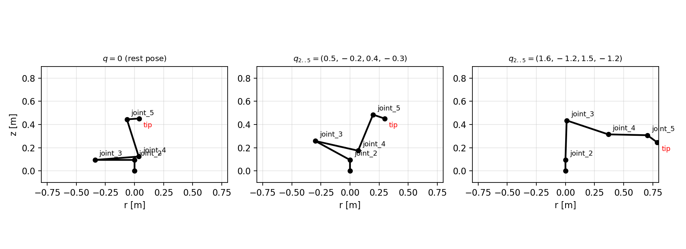
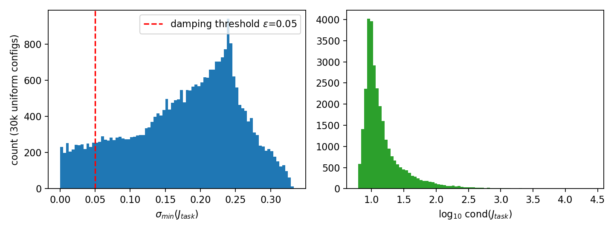
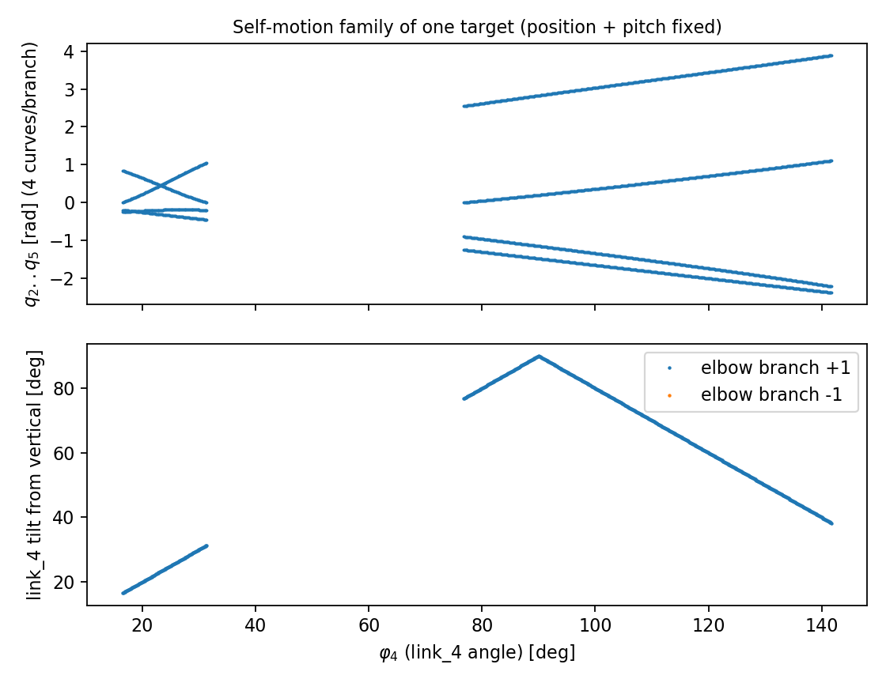
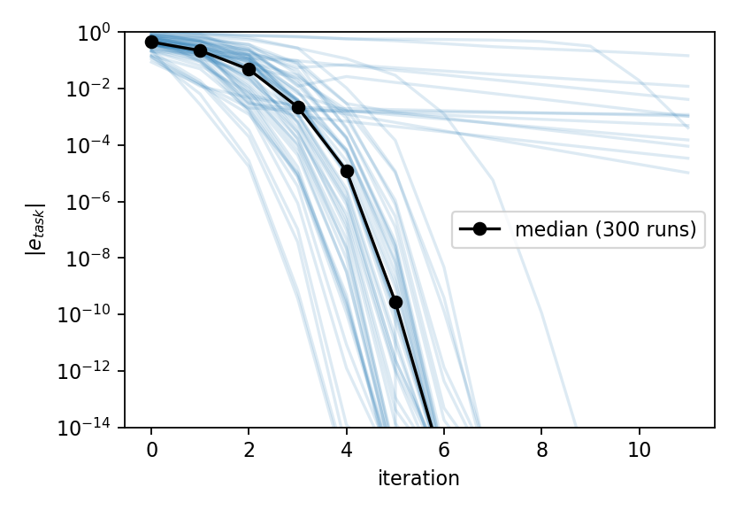
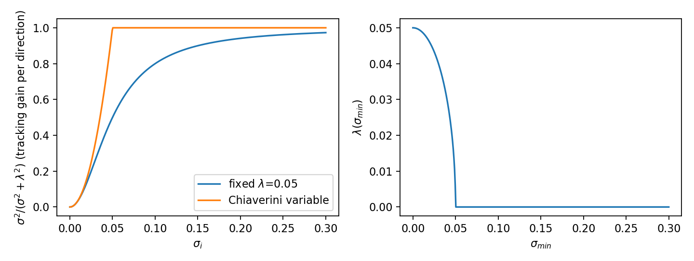
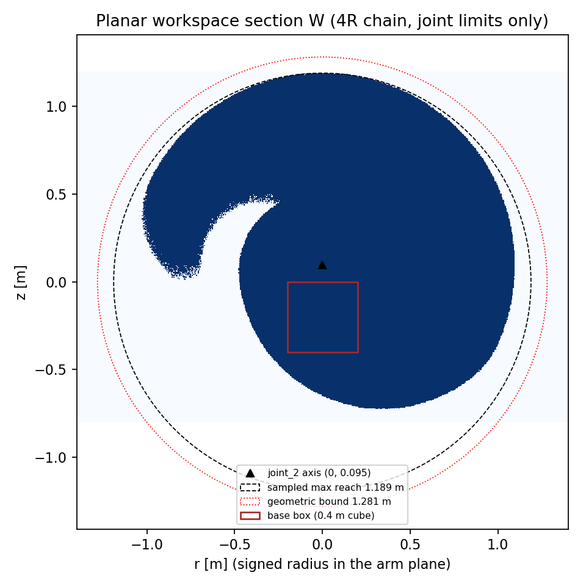
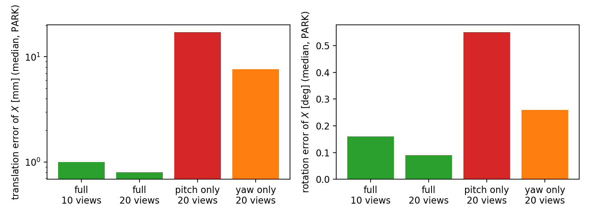
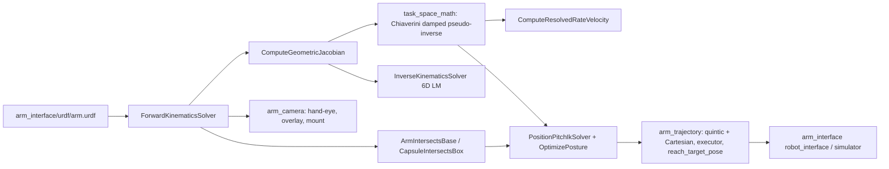
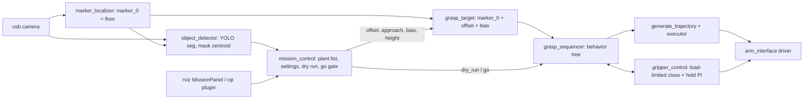

# Kinematics of a 5-DOF Serial Arm: Model, Inverse Kinematics, Redundancy Resolution, Calibration and Implementation

*Technical report / thesis chapter draft.* Packages: `arm_kinematics` (core), with the interfaces to `arm_trajectory`, `arm_interface` and `arm_camera`. Date: 2026-10-07. Primary reference: **B. Siciliano, L. Sciavicco, L. Villani, G. Oriolo, *Robotics: Modelling, Planning and Control*, Springer, 2009 [S]**.

Math is written in LaTeX (`$…$`, `$$…$$`) so the file can go through pandoc into the thesis. Reference keys such as `[S]`, `[NH86]` are listed in §24. Siciliano section numbers marked † are from memory of the book's table of contents; a web lookup of the contents was not possible (publisher page requires a login redirect), so **chapters and topics are reliable, section numbers are not verified**.

**Verification conventions used throughout.** Every numerical claim is one of: *(R)* read from the repository (code, URDF, existing docs, roadmap); *(N)* recomputed here with an independent numpy model (`scripts/report/`), not with the C++ library; *(C)* measured on the C++ library built in the `claude` container; *(S)* simulation with a stated model; *(H)* measured on the real arm and taken from the roadmap/docs, not re-measured here. Anything else is derived on paper and labelled *(derived)*. Heuristic numbers are labelled *(heuristic)*.

---

## Contents

1. Scope, notation, and how to read this report
2. Mathematical preliminaries
3. The arm: model and structure
4. Differential kinematics
5. Inverse kinematics
6. Redundancy resolution and posture optimisation
7. Workspace and base-collision geometry
8. Interface to trajectory generation and the task-space correction loop
9. Calibration: taxonomy and error model
10. Camera model and intrinsic calibration
11. Pose estimation from a planar target
12. Hand–eye calibration
13. Camera mount: known board, hand measurement, and end-to-end error budget
14. Software architecture and implementation
15. Performance, verification and experience on hardware
16. Findings, limitations and future work
17. Task, pipeline and architecture (Part IV: manipulation)
18. Perception for grasping
19. Target frame, bias and the waypoints
20. Gravity sag: measurement and feed-forward compensation
21. Behavior tree, gripper control and mission control
22. Experiments (first grasps 2026-10-14, final experiments 2026-10-16)
23. Findings, limitations and future work for manipulation
24. References
A. Reproducing the numbers

---

## 1. Scope, notation, and how to read this report

**Scope.** The arm is a 5-joint serial manipulator (base yaw + four parallel pitch joints) with a gripper that is not part of the pose chain. This report derives, from the URDF and the code, the mathematical structure of its kinematics, shows why the numerical algorithms in the repository work (and where they are heuristic), and documents the calibration procedures built so far for the eye-in-hand camera. Dynamics and joint-level control are out of scope. Part IV (added 2026-10-17) extends the report to manipulation: the perception-driven grasp and uproot pipeline built on this kinematics, its sag compensation, behavior tree, mission control and the final experiments.

**Notation.** $q=(q_1,\dots,q_5)^\top$ joint angles [rad]; $T=(R,p)\in SE(3)$; $[\,\cdot\,]_\times$ skew-symmetric matrix of a vector; $\hat z,\hat y$ world axes; $\mathrm{Rot}_y(\phi)$ rotation about $y$; $\mathrm{Exp}$/$\mathrm{Log}$ the $SO(3)$ exponential and logarithm; $\sigma_i(\cdot)$ singular values in decreasing order; $J^\dagger$ the Moore–Penrose pseudo-inverse; $J^\#_\lambda$ the damped one. Frames: `base_link` (b), `end_effector` (e, the tool point 0.105 m beyond `link_5`), camera optical frame (c; $z$ out of the lens, $x$ right, $y$ down), calibration board (B).

**Conventions.** URDF `rpy` = fixed-axis $R=\mathrm{Rot}_z(\text{yaw})\mathrm{Rot}_y(\text{pitch})\mathrm{Rot}_x(\text{roll})$ (REP-103); Jacobian in the *spatial* (base-frame) convention; metres and radians; joints within the URDF limits.

**Structure.** Part I (§§2–8) is the kinematics proper; Part II (§§9–13) is calibration and the error budget; Part III (§§14–16) is implementation, measurements and open issues; Part IV (§§17–23) is manipulation (perception-driven grasping and uprooting, experiments of 2026-10-14 to 2026-10-16). Corrections to earlier repository documents are collected in §16.1.

---

## 2. Mathematical preliminaries

### 2.1 Rotations and rigid motions ([S] Ch. 2)

$SO(3)=\{R\in\mathbb R^{3\times3}: R^\top R=I,\ \det R=1\}$. For a unit axis $u$ and angle $\theta$, Rodrigues' formula gives the exponential map

$$\mathrm{Exp}(\theta u)=I+\sin\theta\,[u]_\times+(1-\cos\theta)\,[u]_\times^2 ,$$

and the logarithm of $R$ with $\theta=\arccos\frac{\mathrm{tr}R-1}{2}$ is $\mathrm{Log}(R)=\frac{\theta}{2\sin\theta}(R-R^\top)^\vee$ (singular at $\theta=\pi$, handled separately in the code through `Eigen::AngleAxisd`). A rigid transformation is $T=\begin{psmallmatrix}R&p\\0&1\end{psmallmatrix}\in SE(3)$ with $T^{-1}=\begin{psmallmatrix}R^\top&-R^\top p\\0&1\end{psmallmatrix}$. Composition of the chain is a matrix product, which is why forward kinematics is cheap (§14.3).

### 2.2 Velocities

For a time-varying rotation, $\dot R=[\omega]_\times R$ (spatial angular velocity $\omega$). For a point rigidly attached to the end effector, $\dot p_e=\dot p_i+\omega_i\times(p_e-p_i)$ — the identity on which the geometric Jacobian (§4.1) rests. A small rotation applied on the left of $R$ is $R(q+\delta q)\approx\mathrm{Exp}(J_\omega\delta q)R(q)$; this is what makes the base-frame rotation-vector error $\mathrm{Log}(R_dR^\top)$ the consistent orientation error for a base-frame $J_\omega$ (§5.3).

### 2.3 Least squares, pseudo-inverse, SVD

For $J\in\mathbb R^{m\times n}$ with SVD $J=U\Sigma V^\top$ the pseudo-inverse is $J^\dagger=V\Sigma^{+}U^\top$. If $\mathrm{rank}\,J=m$ (full row rank): $J^\dagger=J^\top(JJ^\top)^{-1}$, the minimum-norm solution of $J\dot q=\dot x$, and $JJ^\dagger=I_m$. The Tikhonov (damped) problem

$$\min_{\dot q}\ \|J\dot q-\dot x\|^2+\lambda^2\|\dot q\|^2\ \Longrightarrow\ \dot q=(J^\top J+\lambda^2 I)^{-1}J^\top\dot x=J^\top(JJ^\top+\lambda^2 I)^{-1}\dot x=\sum_i\frac{\sigma_i}{\sigma_i^2+\lambda^2}(u_i^\top\dot x)\,v_i \tag{2.1}$$

(the middle equality is the push-through identity $(J^\top J+\lambda^2I)^{-1}J^\top=J^\top(JJ^\top+\lambda^2I)^{-1}$, which follows from $J^\top(JJ^\top+\lambda^2I)=(J^\top J+\lambda^2I)J^\top$). Equation (2.1) is the basis of every solver in this package; the "left" and "right" forms used for the 6×5 and 4×5 tasks respectively are the *same* operator. References: [GVL13], [NH86], [Wam86], [S] §3.5†.

---

## 3. The arm: model and structure

### 3.1 Description in the URDF

The chain used by the solvers is (`arm_interface/urdf/arm.urdf`):

`base_link` →(joint_1, z)→ `link_1` →(joint_2, y)→ `link_2` →(joint_3, y)→ `link_3` →(joint_intermediate, fixed)→ `link_intermediate` →(joint_4, y)→ `link_4` →(joint_5, y)→ `link_5` →(end_effector_joint, fixed)→ `end_effector`.

| joint | origin $xyz$ [m] | origin pitch [rad] | axis | limits [rad] | $v_{max}$ |
|---|---|---|---|---|---|
| joint_1 | (0, 0, 0.03) | 0 | $z$ | [−2.745, 2.736] | 2 rad/s |
| joint_2 | (0, 0, 0.065) | −1.57 | $y$ | [0, 3.14] | 2 |
| joint_3 | (0, 0, 0.34) | 0 | $y$ | [−2.220, 0] | 2 |
| joint_intermediate | (0.029, 0, 0) | 3.1412 | fixed | — | — |
| joint_4 | (0, 0, 0.376) | −1.8791 | $y$ | [0, 4.505] | 2 |
| joint_5 | (0, 0, 0.336) | 1.81 | $y$ | [−3.620, 0] | 2 |
| end_effector_joint | (0, 0, 0.105) | 0 | fixed | — | — |

*(R)* All origin roll/yaw are zero. The gripper (`joint_6`, prismatic, plus a mirror finger) branches off `end_effector` and is not on the path from `base_link` to the tip, so `ForwardKinematicsSolver` (which walks `parent_joint` from the tip to the root, `forward_kinematics.cpp`) never sees it. Making the tip transform a **fixed** offset removed a spurious DOF: an earlier revolute `joint_6` coincident with its own translation axis made the tip orientation depend on an unrelated gripper angle (roadmap, M2).

**Per-joint transform and chain** ([S] §2.8†, open kinematic chain):
$$T_i(q_i)=\mathrm{Trans}(xyz_i)\,\mathrm{Rot}(rpy_i)\,\mathrm{Rot}(\text{axis}_i,q_i),\qquad T(q)=\prod_i T_i .$$
Equivalent product-of-exponentials form [MLS94], [LP17]: $T(q)=e^{[\mathcal S_1]q_1}\cdots e^{[\mathcal S_5]q_5}M$ with $M=T(0)$ and screw axes $\mathcal S_i=(\omega_i;-\omega_i\times p_i)$ taken at $q=0$. The repository uses origin+axis, the form URDF/TF use, so FK and `robot_state_publisher` agree by construction.

### 3.2 Structure theorem: yaw followed by a planar 4R

**Proposition 3.1 (planarity).** Joints 2–5 and all fixed rotations after joint_1 are rotations about the same $y$ axis. Rotations about one axis commute and add. Hence the transform from `link_1` to the tip is $\mathrm{Trans}$'s composed with $\mathrm{Rot}_y(\varphi)$, and every point of the chain after joint_1 stays in the plane spanned by the radial direction and $\hat z$. *Proof:* each $T_i$ for $i\ge2$ is $\mathrm{Trans}(x_i,0,z_i)\mathrm{Rot}_y(\cdot)$ (no $y$ translation, no roll/yaw), and the product of such transforms preserves the plane $y=0$ of the frame after $\mathrm{Rot}_z(q_1)$. ∎

Define the absolute link angles ($\varphi$ is the angle of a link's local $z$ axis from world $z$ towards the radial axis; $\mathrm{Rot}_y(\varphi)\hat z=(\sin\varphi,0,\cos\varphi)$, $\mathrm{Rot}_y(\varphi)\hat x=(\cos\varphi,0,-\sin\varphi)$):

$$\begin{aligned}
\varphi_2&=q_2-1.57, & \varphi_3&=\varphi_2+q_3, & \varphi_i&=\varphi_3+3.1412,\\
\varphi_4&=\varphi_i-1.8791+q_4=q_2+q_3+q_4-0.3079, & \varphi_5&=\varphi_4+1.81+q_5=q_2+q_3+q_4+q_5+1.5021 .
\end{aligned}$$

With $s(\varphi)=(\sin\varphi,\cos\varphi)$, $c(\varphi)=(\cos\varphi,-\sin\varphi)$, the planar tip position is

$$\begin{pmatrix}r\\z\end{pmatrix}=\begin{pmatrix}0\\0.095\end{pmatrix}+0.34\,s(\varphi_2)+0.029\,c(\varphi_3)+0.376\,s(\varphi_i)+0.336\,s(\varphi_4)+0.105\,s(\varphi_5),\qquad p=\begin{pmatrix}r\cos q_1\\ r\sin q_1\\ z\end{pmatrix},\quad R=\mathrm{Rot}_z(q_1)\mathrm{Rot}_y(\varphi_5). \tag{3.1}$$

$r$ is a *signed* radius (the tip can lie behind the joint-1 axis). *(N)* Eq. (3.1) agrees with the URDF-composed FK to $<10^{-9}$ at $q=0$ (tip $(0.0389,0,0.4515)$ m) and at $q=(0.3,0.5,-0.2,0.4,-0.3)$ (tip $(0.2839,0.0878,0.4510)$ m), and with the repository's own independent reference values (`docs/fk_reference.py`, which stops at `link_5`, i.e. 0.105 m earlier along its $z$).



**Effective forearm link.** The pair (`joint_intermediate`, joint_4) is an offset elbow: $0.029\,c(\varphi_3)+0.376\,s(\varphi_i)=\rho\,s(\varphi_3+\beta)$ with $\rho=0.37713$ m and $\beta=3.0642$ rad ($=\pi-0.0774$). So the planar chain is a 4R with link lengths $l_2=0.34,\ \rho=0.37713,\ l_4=0.336,\ l_{tool}=0.105$ m and shoulder height 0.095 m.

### 3.3 Denavit–Hartenberg equivalent

Siciliano uses the standard DH convention ([S] §2.8.2†, [DH55]); the URDF has none, so the equivalent table was constructed and checked. With $z_1$ along joint 2's axis ($\alpha_1=-\pi/2$, $d_1=0.095$), the planar angles in DH form are $\theta^{abs}=\varphi-\pi/2$ (DH angle measured from the radial axis towards "down"), giving *(N)*

| $i$ | $a_i$ [m] | $\alpha_i$ | $d_i$ [m] | $\theta_i$ |
|---|---|---|---|---|
| 1 | 0 | $-\pi/2$ | 0.095 | $q_1$ |
| 2 | 0.34 | 0 | 0 | $q_2-1.57-\pi/2=q_2-3.1408$ |
| 3 | 0.37713 | 0 | 0 | $q_3+\beta=q_3+3.0642$ |
| 4 | 0.336 | 0 | 0 | $q_4+(1.2621-\beta)=q_4-1.8021$ |
| 5 | 0.105 | 0 | 0 | $q_5+1.81$ |

followed by the constant frame change to the URDF `end_effector` (columns $[y_5,z_5,x_5]$: tool $z$ along the last link, tool $y$ along $z_5$). *(N)* Composing this table reproduces the URDF FK to $9\times10^{-16}$ over 500 random in-limit configurations. The table shows the standard textbook structure of an **anthropomorphic-type "shoulder yaw + planar arm"** with an offset elbow; there is no spherical wrist, so the Pieper decoupling of [S] §2.12† does not apply, which is why the problem reduces to a planar IK with one redundant parameter (§5.2).

### 3.4 Consequences of the structure

* **Roll ≡ 0 and yaw is slaved to position.** From (3.1), $R=\mathrm{Rot}_z(q_1)\mathrm{Rot}_y(\varphi_5)$ has no roll, and its yaw is $q_1$ (or $q_1+\pi$ if $r<0$), which equals the azimuth $\mathrm{atan2}(p_y,p_x)$ of the tip (plus $\pi$ if $r<0$). The reachable poses therefore form a **4-dimensional** submanifold of $SE(3)$:
$$\mathcal M=\{(p,\ \mathrm{Rot}_z(\mathrm{atan2}(p_y,p_x)+\pi\,[r<0])\,\mathrm{Rot}_y(\varphi))\},\quad\dim\mathcal M=4\ \text{(parametrised by }(q_1,r,z,\varphi_5)).$$
* **Tool $y$ axis equals the common joint axis.** $R\hat y=\mathrm{Rot}_z(q_1)\hat y=:\hat a$, which is also the world axis of joints 2–5. *(N)* verified exactly (difference 0) at random configurations.
* **Maximum reach** (triangle inequality on the origin offsets): $0.03+0.065+0.34+0.029+0.376+0.336+0.105=1.281$ m for any $q$; the sampled maximum is 1.189 m.
* **Joint limits.** The sums are asymmetric: $q_2\in[0,3.14]$, $q_3\le0$, $q_4\ge0$, $q_5\le0$; the joint-1 range is 5.481 rad, leaving a 0.802 rad (46°) dead wedge behind the base.

---

## 4. Differential kinematics

### 4.1 Geometric Jacobian

Differentiating the chain (§2.2): joint $i$ with world axis $z_i$ and world origin $p_i$ (axis frame after its fixed origin and before its own rotation; the origin of the axis does not move when $q_i$ changes) contributes the twist $(z_i\times(p_e-p_i);\,z_i)\dot q_i$. Therefore ([S] §3.1–3.2†, `jacobian.cpp`)

$$J=\begin{pmatrix}J_v\\J_\omega\end{pmatrix}\in\mathbb R^{6\times5},\qquad J_{v,i}=z_i\times(p_e-p_i),\quad J_{\omega,i}=z_i. \tag{4.1}$$

*Validation* (`test_jacobian.cpp`): central finite differences of FK; for the angular block, $R(q+he_i)R(q-he_i)^\top\approx\mathrm{Exp}(2hz_i)$ so $\mathrm{Log}(\cdot)/2h\to z_i$; agreement $\sim10^{-5}$ (truncation error).

### 4.2 Structure of $J$ for this arm

Work in the cylindrical basis $(\hat e_r,\hat e_\theta,\hat z)$ at the current $q_1$, with $\hat e_\theta=\hat a$. For joint 1: $z_1=\hat z$, $p_e-p_1=r\hat e_r+(z_e-0.03)\hat z$, so $J_{v,1}=r\hat e_\theta$, $J_{\omega,1}=\hat z$. For joints $2,\dots,5$: $z_i=\hat a=\hat e_\theta$ and $\hat e_\theta\times(\Delta r_i\hat e_r+\Delta z_i\hat z)=\Delta z_i\hat e_r-\Delta r_i\hat z$ with $\Delta r_i=r_e-r_i$, $\Delta z_i=z_e-z_i$. In components $(v_r,v_\theta,v_z,\omega_r,\omega_\theta,\omega_z)$:

$$J=\begin{pmatrix}
0&\Delta z_2&\Delta z_3&\Delta z_4&\Delta z_5\\
r&0&0&0&0\\
0&-\Delta r_2&-\Delta r_3&-\Delta r_4&-\Delta r_5\\
0&0&0&0&0\\
0&1&1&1&1\\
1&0&0&0&0\end{pmatrix}. \tag{4.2}$$

**Proposition 4.1 (rank).** The end-effector twist always satisfies two linear constraints, $\omega_r=0$ and $v_\theta=r\,\omega_z$; hence $\mathrm{rank}\,J\le4$ for every configuration, and $\dim\ker J\ge1$. ∎ *(N)* $\sigma_5(J)=7\times10^{-17},\,1\times10^{-17},\,7\times10^{-17},\,9\times10^{-17},\,1\times10^{-18}$ at five random in-limit configurations, and $\sim10^{-16}$ at $q=0$ and two further poses.

**Proposition 4.2 (null space).** Let $c_i=(\Delta z_i,-\Delta r_i,1)^\top$, $i=2..5$ (the planar $(v_r,v_z,\omega_\theta)$ block). A null vector of the 3×4 planar block, with zero $q_1$ component, is given by the signed minors (generalised cross product)
$$n_i=(-1)^i\det[c_j]_{j\ne i}=(-1)^i\,2A_{\bar i},$$
where $A_{\bar i}$ is the signed area of the triangle formed by the *other three* planar joint centres. ($\det[(a_j,b_j,1)]$ with $(a_j,b_j)=$ the 90°-rotated vector $p_e-p_j$ equals twice the signed triangle area, since a rotation and a translation preserve area.) The row of ones gives $\sum_{i=2}^5n_i=0$: the self-motion preserves the tool pitch. *(N)* verified: for four random configurations the signed-area vector equals the SVD null vector to four digits, with zero $q_1$ component. ∎

**Task Jacobian.** The solvers use $J_{task}=\begin{pmatrix}J_v\\\hat e_p^\top J_\omega\end{pmatrix}\in\mathbb R^{4\times5}$ with $\hat e_p=R\hat y$ the tool pitch axis. Because $R\hat y=\hat a$ and $\hat a^\top\hat z=0$, $\hat a^\top\hat a=1$, the pitch row is the **constant** $(0,1,1,1,1)$ *(N)* verified. $J_{task}$ has full row rank 4 away from singularities and $\ker J_{task}=\ker J$.

### 4.3 Singularities ([S] §3.3†)

**Proposition 4.3.** $J_{task}$ loses rank iff (a) $r=0$ (the tip is on the joint-1 axis: the $v_\theta$ row $(r,0,0,0,0)$ vanishes) or (b) all four planar joint centres $(r_i,z_i)$, $i=2..5$, are collinear (all signed triangle areas of Prop. 4.2 vanish, i.e. all four minors $=0$, i.e. the planar $3\times4$ block has rank $<3$). *Proof:* rows of (4.2) other than the structural ones are the block $(v_r;v_z;\omega_\theta)$ plus the $v_\theta$ row; the block has rank 3 iff the columns $(a_i,b_i,1)$ span $\mathbb R^3$, i.e. iff the points are not all on one line. ∎

*Note on $q=0$.* *(N)* The planar joint centres at $q=0$ are $(0,0.095),(-0.34,0.0953),(0.036,0.1241),(-0.0658,0.4443)$, tip at $(0.0389,0.4515)$: **not collinear** (the matrix of centred coordinates has singular values 0.50, 0.35). $\sigma_{min}(J_{task})=0.039$ at $q=0$. So $q=0$ is a poorly conditioned pose with four joints pinned at limits ($q_2=q_4=0$ lower, $q_3=q_5=0$ upper), **not a rank-dropping singularity**. (The repository previously cited a $10^{-33}$ singular value of the 6×5 Jacobian; that is the structural zero of Prop. 4.1, present everywhere.)

### 4.4 Conditioning statistics, manipulability

Yoshikawa's measure $w=\sqrt{\det(J_{task}J_{task}^\top)}=\prod_{i=1}^4\sigma_i$ [Yos85]. *(N)*, 30 000 uniform in-limit configurations:

| quantity | percentiles |
|---|---|
| $\sigma_{min}(J_{task})$ | 1 %: 0.0055, 5 %: 0.028, 10 %: 0.054, 50 %: 0.189, 90 %: 0.269 |
| fraction with $\sigma_{min}<0.05$ | 9.3 % ($<0.01$: 1.8 %) |
| $w$ | 5 %: 0.0047, 50 %: 0.058, 95 %: 0.223 |
| $\kappa=\sigma_1/\sigma_4$ | 50 %: 11.5, 90 %: 39.5, 99 %: 386 |



Units caveat: the first three rows of $J_{task}$ are m/rad and the last is rad/rad, so $\sigma$ mixes units; a threshold such as 0.05 is a scale choice, not a physical quantity.

---

## 5. Inverse kinematics

### 5.1 Problem statement and existence

Given $(p_d,R_d)$ find $q\in\mathcal Q$ (the joint box) with $T(q)=T_d$. By §3.4: a solution exists only if $(p_d,R_d)\in\mathcal M$ (roll 0, yaw = azimuth) **and** the planar problem is feasible within limits. A generic 6D target is off $\mathcal M$, so the full-pose problem has only a least-squares answer; the day-to-day target is therefore (position, pitch) ∈ ℝ⁴, for which a solution exists whenever the planar problem does.

### 5.2 Closed-form solution set (derived here; the repository solves numerically)

Let the target be $p_d=(x,y,z)$, tool pitch $\Phi=\varphi_5$.

1. **Base branches:** $q_1=\mathrm{atan2}(y,x)$, $r=+\sqrt{x^2+y^2}$; or $q_1+\pi$ with $r=-\sqrt{x^2+y^2}$ (feasible only if inside the joint-1 range).
2. **Wrist point:** $p_5=(r,z)-l_{tool}\,s(\Phi)$.
3. **Free parameter** $\varphi_4\in(-\pi,\pi]$: $p_4=p_5-l_4\,s(\varphi_4)$.
4. **Planar two-link problem:** with $d=p_4-(0,0.095)$, $d=l_2\,s(\varphi_2)+\rho\,s(\varphi_2+q_3+\beta)$. By the law of cosines ([S] §2.12†, planar two-link arm),
$$\cos(q_3+\beta)=\frac{\|d\|^2-l_2^2-\rho^2}{2l_2\rho},\quad q_3=-\beta\pm\arccos(\cdot),\quad \varphi_2=\arg(d_z+i d_r)-\arg\!\big(l_2+\rho e^{i(q_3+\beta)}\big),$$
requiring $|\cos(\cdot)|\le1$ (otherwise $p_4$ is outside the annulus reachable by the shoulder links).
5. $q_2=\varphi_2+1.57$, $q_4=\varphi_4-\varphi_i+1.8791$, $q_5=\Phi-\varphi_4-1.81$, each wrapped mod $2\pi$ into its limits.

So the solution set is a **one-parameter family in $\varphi_4$, times two elbow branches, times two base branches**, cut by the joint box. This is the exact content of "1-D null space" and of the "distinct basins" that necessitate restarts in numerical IK.

*(N) Verification.* On 2000 random configurations the construction recovers the generating $q$ in 2000/2000 cases (max error $2\times10^{-14}$); on 300×5 random $\varphi_4$ values it returned 0 solutions whose pose differed from the target (position and full rotation, tolerance $10^{-9}$).



*(N)* Over 1500 random targets, the feasible set of $\varphi_4$ on the target's own base branch consists of one interval in 90 % of the cases and two disjoint intervals in 10 %; on average a branch is feasible over 11.6 % of the $\varphi_4$ circle (≈42°). The disjoint intervals are the discrete solution **components**: a continuous self-motion cannot cross between them, and the executor interpolates in joint space, so switching component requires a joint-space path check (not implemented).

### 5.3 Numerical formulation shared by both solvers

**Error.** Position error $e_p=p_d-p$; orientation error as a rotation vector $e_o=\mathrm{Log}(R_dR^\top)$ (base-frame, consistent with the spatial $J_\omega$ by §2.2). [S] §3.7.3† uses the unit-quaternion error $e_O=\eta\epsilon_d-\eta_d\epsilon-[\epsilon_d]_\times\epsilon$; for small errors $e_O\approx\tfrac12e_o$, so the two differ in effective gain (a factor 2), not direction. The rotation vector is numerically safe at $\theta\to0$ (axis undefined, but $\theta u\to0$).

*Full pose* (`InverseKinematicsSolver`): $e=(e_p;e_o)\in\mathbb R^6$, weight $W=I$.
*Position + pitch* (`PositionPitchIkSolver`): $e_{task}=(e_p;\ \hat e_p^\top e_o)\in\mathbb R^4$ with $\hat e_p=R_k\hat y$ re-evaluated at every iterate (the same body-frame pitch as `ComputeResolvedRateVelocity`).

### 5.4 Closed-loop IK and Lyapunov analysis ([S] §3.7†)

Continuous-time: $\dot q=J^\#Ke$, $K=kI$. For constant $x_d$, $\dot e=-J\dot q$ (taking $J$ as the Jacobian matching the error coordinates). With $V=\tfrac12e^\top e$,

$$\dot V=e^\top\dot e=-k\,e^\top JJ^\#e .$$

* Exact right pseudo-inverse and full row rank ($m=4$): $JJ^\#=I_4$, so $\dot V=-k\|e\|^2<0$: exponential convergence, rate $k$ (local, since $x(q)$ is nonlinear and $q$ is constrained by limits).
* Damped: with $J=U\Sigma V^\top$, $JJ^\#_\lambda=U\,\mathrm{diag}\!\big(\tfrac{\sigma_i^2}{\sigma_i^2+\lambda^2}\big)U^\top$, so
$$\dot V=-k\sum_i\frac{\sigma_i^2}{\sigma_i^2+\lambda^2}\,(u_i^\top e)^2<0\quad\text{whenever some }\sigma_i>0 \text{ and }u_i^\top e\ne0 ,$$
but the decay rate of the component along $u_i$ is $k\sigma_i^2/(\sigma_i^2+\lambda^2)\to0$ as $\sigma_i\to0$ (the price of bounded $\dot q$ near singularities, and the "direction bias" of §5.5).

### 5.5 Discrete iteration: Gauss–Newton, Levenberg–Marquardt, damping schedules

Euler discretisation with $k\Delta t=1$ gives $\Delta q=J^\dagger e$, the **minimum-norm Newton step** for the underdetermined system $e(q)=0$ (Ben-Israel 1966 [BI66]); for $e\in\mathbb R^m$ with $J$ of full row rank the iteration converges locally quadratically to a point of the solution manifold. *(S)* A numpy port of the position+pitch iteration (Chiaverini damping, clamp 0.2 rad, limit clipping, no restarts) from 300 seeds 0.3 rad (σ) away from a reachable target gives median error per iteration

| iteration | 0 | 1 | 2 | 3 | 4 | 5 | 6 |
|---|---|---|---|---|---|---|---|
| $\lVert e\rVert$ | 0.45 | 0.23 | 0.049 | $2.3\times10^{-3}$ | $1.2\times10^{-5}$ | $2.8\times10^{-10}$ | $3\times10^{-16}$ |

— the ratios $e_{k+1}/e_k^2\approx2.4,\ 2.0$ confirm quadratic convergence in the last iterations. 269/300 runs reach $10^{-10}$ in ≤40 iterations (median 6); the others stall (median final error $10^{-5}$) at joint limits or near-singular poses, which is what restarts and the backtracking line search address.



**Damped (Levenberg–Marquardt) form.** The step minimises $\|J\Delta q-e\|_W^2+\lambda^2\|\Delta q\|^2$, i.e. $(J^\top WJ+\lambda^2I)\Delta q=J^\top We$ ([Lev44], [Mar63], [NH86], [Wam86], [Sug11], [NW06] Ch. 10); by (2.1) it is the same operator as $J^\top(JJ^\top+\lambda^2W^{-1})^{-1}e$. This resolves a point that earlier repository text stated differently: the *left* (normal-equation) form for the 6×5 full-pose solver and the *right* form for the 4×5 task are the same algebra; they differ in which task rows they are given. With $\mathrm{rank}\,J=4<5$, $J^\top WJ$ is singular, and it is the damping term that keeps $J^\top WJ+\lambda^2I$ invertible.

**Two schedules are used.**

1. *Adaptive LM* (`inverse_kinematics.cpp`): accept a step only if the weighted cost $e^\top We$ decreases; accepted ⇒ $\lambda\leftarrow0.5\lambda$, rejected ⇒ $\lambda\leftarrow3\lambda$ (≤10 retries). Monotone cost decrease ⇒ convergence to a stationary point of $\frac12e^\top We$ ([NW06]); local, not global. Step clamp $\|\Delta q\|_\infty\le0.2$ rad, joint-limit clipping.
2. *Variable (Chiaverini) damping* (`task_space_math.cpp`, shared by resolved rate and position+pitch IK), after the singular-value-dependent damping of [NH86], [CSE94], [Chi97]:
$$\lambda^2(\sigma_{min})=\begin{cases}0,&\sigma_{min}\ge\varepsilon\\ \lambda_{max}^2\big(1-(\sigma_{min}/\varepsilon)^2\big),&\text{otherwise}\end{cases},\qquad\sigma_{min}=\sqrt{\lambda_{min}(J_{task}J_{task}^\top)} .$$
Away from singularities this is the **exact** pseudo-inverse (no direction bias); a fixed $\lambda$ scales direction $i$ by $\sigma_i^2/(\sigma_i^2+\lambda^2)$, which *rotates* a multi-component command (measured 2–4 % at $\lambda=0.05$ in `test_resolved_rate.cpp`). Near singularities it tapers continuously to the fixed-$\lambda$ law ($\lambda\to\lambda_{max}$ as $\sigma_{min}\to0$).



*Heuristic flagged:* the code sets $\lambda_{max}=\varepsilon=0.05$ (one parameter `damping`); the literature treats them as independent. By §4.4 the damped regime is active in ≈9 % of the joint box.

### 5.6 The position + pitch solver in detail (`position_pitch_ik.cpp`)

Each iteration: $\Delta q=J_{task}^\top\big(J_{task}J_{task}^\top+\lambda^2(\sigma_{min})I\big)^{-1}e_{task}$, clamped to $\|\Delta q\|_\infty\le0.2$ rad. Additions that are not in the textbook scheme, each introduced to cure a measured failure (details in `position_pitch_ik.md`):

* *Backtracking line search* on $\|e_{task}\|^2$ when no posture task is active (halve the step ≤5 times): stops wandering on interior path samples that are off the reachable set.
* *Final refinement:* ≤6 further Newton steps below 10 % of the tolerance once inside it (otherwise each sample jumps by up to tolerance/$|J|$).
* *`converged` and `residual` computed once from the true final $q$*, never latched mid-loop.
* *Restart selection tiers* in `Solve()`: collision-free ≻ within $10\times$ tolerance (when a posture task is on) ≻ lower residual / better alignment.

### 5.7 Why restarts are needed, and how many

By §5.2 the solution set has up to $2\times2$ discrete branches, each with up to two disjoint $\varphi_4$ components; local descent finds the one nearest the seed, and clipping at joint limits creates further stalls. Restarts (`max_restarts = 20`, both headers) draw uniform seeds in the joint box. *(R)* Benchmark of the repository (20 targets): fixed $\lambda$ 40 %, adaptive $\lambda$ alone 35 %, adaptive + restarts 100 % — adaptive damping changes *how* a basin is descended, restarts *which* basin. *(C)* On 300 random targets: position+pitch from a 0.3 rad warm seed converges 300/300 (mean 8.9 iterations); from a random seed 295/300 with a mean of 2.1 restarts; full-pose LM from a random seed 300/300. A geometric model $P(\text{fail after }R\text{ restarts})=(1-p)^{R+1}$ with $E[\text{restarts}]=(1-p)/p\approx2.1$ gives a per-seed success probability $p\approx0.32$ *(derived, illustrative)*.

### 5.8 Heuristic constants (not derived)

| constant | value | location |
|---|---|---|
| position / orientation (pitch) tolerance | $10^{-4}$ m / $10^{-3}$ rad | both solvers (header defaults; launch files may override) |
| max iterations | 100 (full pose) / 200 (position+pitch) | |
| max step ($\infty$-norm) | 0.2 rad | |
| LM start / decrease / increase | 0.05 / 0.5 / 3 | standard defaults, not tuned |
| $\varepsilon=\lambda_{max}$ | 0.05 | §5.5 |
| `max_inner_retries` | 10 (full) / 5 (pos+pitch) | |
| drift-cap multiplier | $10\times$ tolerance | |
| `max_restarts` | 20 | |

---

## 6. Redundancy resolution and posture optimisation

### 6.1 Velocity-level resolution (Whitney, Liégeois)

For $\dot x=(v;\omega_{pitch})\in\mathbb R^4$ and $n=5$ joints the redundancy degree is $n-m=1$ (§4.2). The general solution of $J_{task}\dot q=\dot x$ is ([S] §3.4–3.5†; [Whi69], [Lie77])

$$\dot q=J^\#\dot x+(I-J^\#J_{task})\dot q_0 . \tag{6.1}$$

**Lemma 6.1.** For the exact pseudo-inverse, $N=I-J^\dagger J$ is the orthogonal projector onto $\ker J$: $N^\top=N$ (since $J^\dagger J$ is symmetric), $N^2=N$ (since $J^\dagger JJ^\dagger J=J^\dagger J$), and $JN=J-JJ^\dagger J=0$. So $\dot q_0$ cannot change the task velocity. ∎

**Lemma 6.2 (leakage with damping).** With $J^\#_\lambda=J^\top(JJ^\top+\lambda^2I)^{-1}$ and $J=U\Sigma V^\top$,
$$J(I-J^\#_\lambda J)=\lambda^2(JJ^\top+\lambda^2I)^{-1}J=U\,\mathrm{diag}\!\Big(\frac{\lambda^2\sigma_i}{\sigma_i^2+\lambda^2}\Big)V^\top,\qquad \Big\|J(I-J^\#_\lambda J)\dot q_0\Big\|\le\max_\sigma\frac{\lambda^2\sigma}{\sigma^2+\lambda^2}\|\dot q_0\|=\frac\lambda2\|\dot q_0\| ,$$
(maximum at $\sigma=\lambda$). With Chiaverini damping $\lambda=0$ where $\sigma_{min}\ge\varepsilon$, so the leakage is exactly zero there and at most $\lambda_{max}/2=0.025$ (relative) elsewhere. ∎ *(derived)* This replaces the earlier qualitative statement that the leakage is "small at $\lambda=0.05$".

### 6.2 Secondary objective: "link_4 vertical"

Cost $H(q)=-|\hat z\cdot\hat\ell_4|$ with $\hat\ell_4=R_4\hat z_{local}$ the long axis of link_4. By (3.1), $\hat\ell_4=\mathrm{Rot}_z(q_1)\mathrm{Rot}_y(\varphi_4)\hat z$, so
$$a:=\hat z\cdot\hat\ell_4=\cos\varphi_4,\qquad\frac{\partial a}{\partial q_i}=\hat z\cdot(z_i\times\hat\ell_4)=-\sin\varphi_4\,\frac{\partial\varphi_4}{\partial q_i}\ \Rightarrow\ \nabla a=-\sin\varphi_4\,(0,1,1,1,0)^\top .$$
(the closed form of the $\dot q_{0,i}=k\,\hat z\cdot(z_i\times\hat a)$ of `resolved_rate.md`; it vanishes at $\hat\ell_4=\hat z$ by the cyclic property of the scalar triple product, and at $\hat\ell_4=-\hat z$ as well). Consequences *(derived)*:

* $a$ depends on the joints only through $S=q_2+q_3+q_4$. "Link_4 vertical (up or down)" is the **hyperplane** $S\in\{0.3079,\ 3.4495,\ 6.5911\}$ (values inside the attainable range of $S$, $[-2.22,\,7.645]$).
* On the 1-D self-motion curve of a fixed target (§5.2), vertical is the intersection of a curve with a hyperplane: generically isolated points, which may lie outside the joint box on the target's component. This is the geometric reason why "9 of 60 targets stayed more than 10° above the best found" and why the optimiser can end against a limit.
* Physical motivation: the gravity moment of link_4 about the horizontal joint axes is $\propto m g\,\ell\sin\varphi_4$, zero when vertical; motor 4 (MX-28) overload shutdowns were observed on hardware (roadmap, 2026-10-05/06).

*(N)* Independent bound: over 1000 uniform configurations the mean link_4 tilt $\arccos|\cos\varphi_4|$ of the arbitrary configuration is 45.4°; the best tilt reachable **on the same base branch** (scan of $\varphi_4$, both elbows, within limits) has mean 15.3°, median 5.0°. (The repository's own 60-target statistics — 41.6° → 12.1° mean — use a different target distribution; magnitudes agree, values are not comparable one-to-one.)

### 6.3 Why the first position-level bias failed, and the posture optimiser

The first implementation added the gradient of the **signed** $a$ to each Newton step. (i) $a=-1$ (vertical, pointing down) is a stationary point of $a$ although it is the same physical goal, so $|a|$ is the right objective; (ii) $|\nabla a|=|\sin\varphi_4|\sqrt3$ vanishes near vertical, so a fixed-gain step converges only at rate $\propto\text{gain}\cdot\sin^2\theta$ (289–925 iterations measured against a 200 cap); (iii) mixing it into every Newton step let its leakage masquerade as divergence and starved the primary task. *(H/C)* Measured over 60 targets: 41.6° with the bias vs 39.4° without.

**Replacement (`OptimizePosture`)**, run after the primary task converged: projected-gradient ascent on $|a|$ over the self-motion manifold $\mathcal C=\{q:\ e_{task}(q)=0\}$ with a retraction ([AMS08] for the concept):

$$g=\mathrm{sign}(a)\nabla a,\quad g_N=(I-V_rV_r^\top)g,\quad\lambda=\min\!\Big(\lambda_{max},\frac{1-|a|}{\|g_N\|}\Big),\quad q^+=\mathrm{Retract}_{\mathcal C}\!\big(q+\lambda g_N/\|g_N\|\big),$$

$V_r$ the right singular vectors of $J_{task}$ for non-zero singular values (so $I-V_rV_r^\top$ is the projector of Lemma 6.1), retraction by ≤8 damped Newton steps to half the tolerance; a step is accepted only if the primary task stays within tolerance and $|a|$ strictly increases, else $\lambda\leftarrow\lambda/2$. **Convergence rate** *(derived)*: near vertical $|a|=\cos\theta\approx1-\theta^2/2$ and $\|g_N\|=\sin\theta\,\|\nabla\theta\|\approx c\theta$; hence $\lambda=\frac{\theta^2/2}{c\theta}=\frac{\theta}{2c}$ and $\Delta\theta=c\lambda=\theta/2$: the step is Newton's method on a **double root** of $1-|a|$, so the tilt halves per iteration (linear, ratio ½). Since $\mathcal C$ is one-dimensional the method is a 1-D line search on a branch; it cannot change branch.

*(H/C) Result (60 targets, repository):* mean tilt 41.6° → 12.1°; improved >5° in 54/60, worse >1° in 1/60, 9/60 more than 10° above the achievable. Hardware poses A/B: tilt 0.3°/3.3° initially. *Not yet verified on the real arm* (simulation only, roadmap).

### 6.4 Limits

No branch switching; joint-limit margin is not penalised (optimum can sit on a limit); no gravity-torque objective (planned once `/arm_interface/motor_load` is calibrated).

---

## 7. Workspace and base-collision geometry

### 7.1 Reachable set

**Monte Carlo (repository).** `workspace_sampler.cpp` draws $q$ uniformly in the box, evaluates FK, counts occupied voxels. Extremal quantities converge (max reach 1.189 m $\le$ 1.281 m bound; bounding box $X[-1.02,1.08]$, $Y[-1.09,1.08]$, $Z[-0.72,1.19]$ m); the **volume does not** (0.18 → 3.9 m³ depending on voxel size and sample count, *(R)*), because boundary cells are hit by few joint draws and a 3-D voxel grid pads thin shells.

**Convergent alternative (derived, (N)).** By Prop. 3.1 the position set is a body of revolution of the planar section $W=\{(r,z)\}$ of the 4R chain, swept over the joint-1 range and over both signs of $r$ ($r<0$ at azimuth $\psi$ equals $r>0$ at $\psi+\pi$). Pappus–Guldin: with $\theta(\rho,z)$ the swept angle (5.481 rad where only one sign of $r$ is available, $2\pi$ where both are, since the two arcs $Q_1$ and $Q_1+\pi$ together cover the circle),

$$V=\iint_{W_\rho}\rho\;\theta(\rho,z)\,d\rho\,dz .$$

A 2-D occupancy grid of the four-joint chain converges far better than a 3-D one: $2\times10^6$, $8\times10^6$, $3.2\times10^7$ samples at 1 cm cells give 4.79, 4.86, 4.89 m³; 0.5 cm cells at $3.2\times10^7$ give 4.83 m³. **$V\approx4.8\pm0.1$ m³** (position only, joint limits only, no self/base collision, occupancy-padded so a mild overestimate), against 7.05 m³ for the sphere of radius 1.189 m. The planar section area is 2.81 m². Not cross-validated against a third method.



The section is a thick crescent with an inner void on the $r<0$ side and a lower bound $z\ge-0.72$ m; the deployed 0.4 m base cube overlaps the reachable region, which is why avoidance (not only detection) matters.

### 7.2 Base collision (`base_collision.cpp`)

The arm is a set of capsules (radius 0.02 m, the maximum link radius in the URDF) on the segments between consecutive joint origins and from the last origin to the tip; the base is an axis-aligned box $[-h,h]^3$ in its own frame (deployed: 0.4 m cube, robot on its top face, box $z\in[-0.4,0]$).

**Exact segment–box distance.** Point–box squared distance is separable, $d^2(x)=\sum_i\max(0,|x_i|-h_i)^2$. Along $x(t)=x_0+tu$, $t\in[0,1]$, each axis term is $0$ while $x_i(t)\in[-h_i,h_i]$ and $(x_i(t)\mp h_i)^2$ outside; value and derivative agree at the junction (both 0), so each term is $C^1$ and convex in $t$ and so is the sum $g(t)$. $g$ is piecewise quadratic with breakpoints where $x_i(t)=\pm h_i$ (≤6 interior). On each piece $g=at^2+bt+c$; the minimum is at an endpoint or at the vertex $-b/2a$ when interior. The global minimum over all pieces is the exact squared distance, no iteration, no tolerance; collision iff $g_{min}\le r_{cap}^2$ (compare [Eri05] Ch. 5).

**Skipping segment 0 is a provable optimisation.** Joints 1 and 2 lie on the $z$ axis at $z=0.03$ and $0.095$ (invariant under $q$), both $>0$, and the box occupies $z\le0$. This is a property of *this* placement; the code comments say it must be re-derived if the box moves.

**Integration.** Checked once per restart candidate (only the final $q$ is ever executed) as the top tier of the selection order; *qualifying-tier-dominates* means an infeasible target (reachable only by colliding) returns `collision_free=true, converged=false`, so a caller must test `converged` to detect "not reachable without colliding".

---

## 8. Interface to trajectory generation and the task-space correction loop

### 8.1 Quintic time scaling ([S] Ch. 4†)

For $q(t)=q_0+\Delta q\,s(t/T)$, requiring $s(0)=0,\ s(1)=1$ and $s'=s''=0$ at both ends gives six conditions on a degree-5 polynomial with the unique solution
$$s(\tau)=10\tau^3-15\tau^4+6\tau^5,\quad s'=30\tau^2(1-\tau)^2,\quad s''=60\tau(1-\tau)(1-2\tau),\quad s'''=60-360\tau+360\tau^2 .$$
* Peak velocity: $s'(\tfrac12)=\tfrac{15}8$, so $\dot q_{max}=\frac{15}8|\Delta q|/T$ and the velocity-limited duration is $T_{min,i}=\frac{15}{8}|\Delta q_i|/v_{max,i}$, $T=\max_iT_{min,i}$ (synchronised arrival).
* Peak acceleration: $s'''=0\Rightarrow\tau=\frac12(1\pm1/\sqrt3)$, $|s''|=10/\sqrt3\approx5.7735$ *(N)* verified numerically; $T\ge\sqrt{5.7735|\Delta q|/a_{max}}$. The acceleration bound was added because small moves otherwise got durations of ~0.09 s (1 cm at 0.2 rad/s) with peak accelerations near 6.5 rad/s².
* Jerk is *not* zero at the ends ($s'''(0)=60$): the profile is $C^2$ but not $C^3$; velocity and acceleration are continuous and zero at both ends, jerk is neither continuous nor limited.

### 8.2 Cartesian paths

$p(t)=p_0+(p_d-p_0)s$, $R(t)=R_0\,\mathrm{Exp}(s\,\mathrm{Log}(R_0^\top R_d))$ (SLERP, [Sho85]); [S] §4.4†. Each sample is IK-solved warm-started from the previous sample with `max_restarts = 0` (a restart could jump to another branch and make the finite-difference joint velocities explode), and the duration is scaled until every joint respects its limit; interior samples are best-effort (§3.4: lerp/SLERP between two points of the 4-D manifold $\mathcal M\subset SE(3)$ leaves $\mathcal M$ generically; with the position+pitch task the reachable part of the path is tracked, and the peak deviation is reported).

### 8.3 Steady-state correction on hardware (`reach_correction.h`)

Dynamixel Position Control Mode has no integral term, so loaded joints stop short. With plant $y=a+d+\nu$ (aim $a$, unknown offset $d$, repeatability noise $\nu$) the node re-aims at $a_{k+1}=a_k+g\,e_k$, $e_k=x_d-y_k$ (a discrete integrator). With $d$ constant, $e_k=x_d-a_k-d-\nu_k$ and hence $e_{k+1}=(1-g)\,e_k-\nu_{k+1}+\nu_k$; the loop is stable iff $|1-g|<1$, $g=1$ is deadbeat, and the residual floor is set by the noise $\nu$ (repeatability), not by the gain. *(H)* One step removed ≈85 % of the offset (34.6 → 5.0 mm; 26.4 → 4.5 mm), a second step added little and sometimes worsened (3.7 → 6.6 mm), consistent with a floor of ≈5 mm = measured repeatability (4–7 mm); hence the trigger 6 mm, cap 6 cm, 2 steps. A pitch compensation (same law about the tool $y$ axis) was added: pose A, $-0.065$ rad → $0.006$ rad after one step; another run $-0.09$ → $-0.014$ rad after one step and $0.0015$ after two.

---

# Part II — Calibration

## 9. Calibration: taxonomy and error model

Following [S] §2.9† (kinematic calibration) and [RMR87], [HW96], four independent layers separate a motor reading from a pixel ray; only the last two are formal calibrations in the repository:

| layer | model | status |
|---|---|---|
| 1. joint mapping | $q_i=\mathrm{sign}_i\,(\mathrm{ticks}_i-\mathrm{bias}_i)\,2\pi/4096$ | hand-set (`ArmInterface.yaml`); URDF-vs-YAML limit drift ≤0.046 rad accepted *(H)*; zero-offset check proposed, not built |
| 2. link geometry | URDF nominal dimensions | **not calibrated**; rounded constants −1.57, 3.1412 |
| 3. camera intrinsics | pinhole + plumb-bob, Zhang | **calibrated on real images** (2026-10-06) |
| 4. hand–eye $X=T_{e}{}^{c}$ | $AX=XB$ | tooling built and tested on synthetic data; real run **deferred**; interim hand measurement in use |

**First-order error propagation.** With parameters $\kappa$ (joint zero errors, link dimensions), the pose error is $\delta x\approx J_\kappa\,\delta\kappa$ ([S] §2.9†). For joint errors alone $\delta p=J_v\,\delta q$; *(N)* the mean norms of the columns of $J_v$ over the joint box are $(0.35,0.55,0.61,0.40,0.11)$ m/rad, so ≈0.5 mm of tip error per mrad of joint error per joint. One encoder tick is $2\pi/4096=1.53$ mrad.

*(N)* **Joint quantisation/noise.** iid joint noise of σ = 1 tick gives a mean tip error of 1.38 mm (95th percentile 3.1 mm) over the joint box.
*(N)* **Rounded URDF constants.** Using exact $-\pi/2$ and $\pi$ in place of $-1.57$ and $3.1412$ shifts the tip by 0.28 mm on average (max 0.57 mm). Both are far below the measured 4–7 mm repeatability *(H)* but systematic and removable; the rounding is currently kept as "as-built".

---

## 10. Camera model and intrinsic calibration

### 10.1 Pinhole with plumb-bob distortion

A point $X_c=(X,Y,Z)$ in the camera frame projects to the normalised coordinates $x=X/Z$, $y=Y/Z$, $r^2=x^2+y^2$,

$$\begin{aligned}x_d&=x(1+k_1r^2+k_2r^4+k_3r^6)+2p_1xy+p_2(r^2+2x^2),\\ y_d&=y(1+k_1r^2+k_2r^4+k_3r^6)+p_1(r^2+2y^2)+2p_2xy,\end{aligned}\qquad
\begin{pmatrix}u\\v\end{pmatrix}=\begin{pmatrix}f_xx_d+c_x\\f_yy_d+c_y\end{pmatrix}$$

(Brown–Conrady [Bro71]; $k_3$ fixed to 0 in `calibrate_intrinsics.py`, `CALIB_FIX_K3`).

### 10.2 Zhang's planar method ([Zha00])

For a planar board ($Z_B=0$) the image of the board point $(X,Y)$ is a homography, $s\,\tilde m=K[r_1\ r_2\ t]\,(X,Y,1)^\top=H(X,Y,1)^\top$. Orthonormality of $r_1,r_2$ gives, with $H=[h_1\ h_2\ h_3]$ and the image of the absolute conic $B=K^{-\top}K^{-1}$ (symmetric, 6 unknowns):
$$h_1^\top Bh_2=0,\qquad h_1^\top Bh_1=h_2^\top Bh_2 .$$
Two constraints per view; ≥3 views determine $B$ (≥2 with zero skew), then $K$ by Cholesky, then $r_1,r_2,t$ per view. This closed form initialises the maximum-likelihood refinement
$$\min_{K,D,\{R_j,t_j\}}\sum_j\sum_k\big\|m_{jk}-\hat m(K,D,R_j,t_j,M_k)\big\|^2,$$
solved by Levenberg–Marquardt (`cv2.calibrateCamera`). The offline tool (`calibrate_intrinsics.py`) adds outlier rounds and resampling spread.

### 10.3 Real result *(H)*

Webcam Microdia Vitade AF, MJPG 1920×1080. 88 views with detected boards; $f\approx1522$ px, $k_1=-0.375$, $k_2=0.173$, field of view 85° diagonal; **0.7 px RMS on the 53 sharp views, 2.2 px on the 35 motion-blurred ones** (blur, not the model, dominates). GUI result and offline refit agree on the lens but differ in the principal point by ≈20 px per axis (GUI (932, 512); refit (952, 532), 8 px from the image centre); reprojection error cannot discriminate (same RMS), the refit is installed because its principal point is the plausible one. Sensitivity *(derived)*: a principal-point error $\delta c$ rotates every viewing ray by $\delta c/f=20/1522=13$ mrad $=0.75^\circ$, i.e. $\approx5$ mm at 0.4 m. Fisheye fits no better (1.268 vs 1.272 px). No focus control is exposed by the camera, so the focal length can change with focus hunting: calibrate at the working distance in steady light.

---

## 11. Pose estimation from a planar target

**PnP.** Per view, $T_{cB}$ is obtained by `solvePnP` with IPPE [CB14] (closed form for planar targets, returning two candidate poses because a planar homography decomposes into two solutions that become nearly indistinguishable when the board is frontal), followed by `solvePnPRefineLM` minimising the reprojection error. The ChArUco code keeps the lowest-error candidate and refuses views where the two are too close ("board too frontal to tell its orientation").

**Corner labelling.** The classic chessboard detector labels consistently; the sector-based detector [DF18] labelled the board from opposite ends in half of the real views, which would corrupt a hand-eye solution, so the code enforces a canonical orientation (origin cell dark) and refuses views whose cell colours cannot be told apart. ChArUco ([GJ14] markers; ids make the orientation unambiguous and partial views usable) is preferred for the mount calibration.

**Accuracy *(S)*.** In the hand-eye simulation of §12.4 (48 corners, 0.5 px noise, board at 0.3–0.5 m) the resulting pose noise is small compared with the arm's own errors; the dominant uncertainty of the whole camera chain is the arm.

---

## 12. Hand–eye calibration

### 12.1 Formulation

For arm poses $i$ (from FK/TF, $T_{b}{}^{e}{}_i$) and camera views of a fixed board ($T_{c}{}^{B}{}_i$ from PnP) the unknown mount $X=T_e{}^c$ and the unknown board pose $B=T_b{}^B$ satisfy $B=T_b{}^e{}_i\,X\,T_c{}^B{}_i$ for all $i$. Eliminating $B$ between samples $i,j$:

$$A_{ij}X=XB_{ij},\quad A_{ij}=(T_b{}^e{}_j)^{-1}T_b{}^e{}_i,\quad B_{ij}=T_c{}^B{}_j\,(T_c{}^B{}_i)^{-1}.$$
Splitting into rotation and translation,
$$R_AR_X=R_XR_B,\qquad(R_A-I)\,t_X=R_Xt_B-t_A .$$
The rotation equation says $R_A$ and $R_B$ are conjugate: same angle, axes related by $\alpha=R_X\beta$ ($\alpha,\beta$ the rotation vectors).

### 12.2 Identifiability

**Proposition 12.1** ([TL89], [SA89]). Two relative motions with non-parallel rotation axes determine $R_X$ uniquely, and then $t_X$ uniquely.
*Proof sketch.* One pair $(\alpha,\beta)$ fixes $R_X$ up to a rotation about $\alpha$: if $R_X$ is a solution so is $\mathrm{Exp}(\phi\hat\alpha)R_X$ (it commutes with $R_A$). A second pair with a different axis removes the freedom. For the translation, $(R_A-I)$ has kernel $\mathrm{span}\{\hat\alpha\}$, so one motion leaves the component of $t_X$ along $\hat\alpha$ undetermined; stacking motions with two non-parallel axes gives a trivial common kernel. ∎

**Arm-specific excitation *(derived)*.** The arm can rotate the tool only about the pitch axis $\hat y_e$ (joints 2–5, fixed in the tool frame) and about base $z$ (joint 1), which in the tool frame is $R^\top\hat z=(-\sin\varphi_5,0,\cos\varphi_5)^\top$. Their inner product with $\hat y_e$ is exactly 0: the two available axes are always orthogonal (best case for conditioning) but there are *only two*; rotation about the tool/optical axis is never excited. A calibration set must therefore combine both: large $q_1$ swings and large pitch swings (the tooling refuses sets with <20° of either, and reports the largest rotation and axis angle after each capture).

### 12.3 Algorithms

OpenCV `calibrateHandEye` with the five methods: Tsai–Lenz [TL89], Park–Martin [PM94], Horaud–Dornaika [HD95], Andreff–Horaud–Espiau [AHE99], Daniilidis (dual quaternions) [Dan99]; Park–Martin solves the rotation by least squares over all pairs, $R_X=(M^\top M)^{-1/2}M^\top$ with $M=\sum_i\beta_i\alpha_i^\top$, then the translation by the stacked linear system. Optimal weighting is treated in [SH06]. The repository solves with all five and reports, for each, the board-pose scatter in $b$ (should be zero for a fixed board) and the reprojection RMS.

### 12.4 Simulation with this arm's kinematics *(S)*

`scripts/report/hand_eye_simulation.py`: true mount = the interim one (yaw 90°, $t=(-0.025,0,-0.06)$ m); board lying flat at $(0.30,-0.10,-0.10)$ m, yaw 10°; arm configurations drawn uniformly from the joint box and kept if the 8×6 inner-corner grid (25 mm) is fully in view at 0.15–0.7 m; real intrinsics; 0.5 px corner noise; PnP IPPE+LM; joint noise 2 ticks; 60 trials. Median (p90) errors for the Park–Martin method:

| excitation | views | rotation error [°] | translation error [mm] | error of a point 0.4 m ahead [mm] |
|---|---|---|---|---|
| full (pitch **and** yaw) | 10 | 0.16 (0.24) | 1.0 (3.8) | 1.1 (3.6) |
| full | 20 | 0.09 (0.16) | 0.8 (1.7) | 0.8 (1.8) |
| pitch only ($q_1$ constant ±0.03 rad) | 20 | 0.55 (0.99) | 17.2 (36.5) | 15.8 (36.8) |
| yaw only (total pitch constant ±0.05 rad) | 20 | 0.26 (0.59) | 7.6 (15.6) | 7.7 (15.6) |

The degenerate sets leave the translation along the single axis undetermined (Prop. 12.1): 8–17 mm instead of ≈1 mm, while the rotation error stays <1° — consistent with the proof (the rotation family is a 1-parameter group about the axis, the unobservable translation is along it).



Noise sweep (20 views, full excitation, Park–Martin): 0.25/0.5/1.0 px corner noise → 0.01°/0.03°/0.05° and 0.1/0.2/0.4 mm; adding joint noise of 1 tick (1.53 mrad) → 0.10°, 0.6 mm; 3 ticks (4.6 mrad) → 0.35°, 1.9 mm. **Caveats:** the simulation has no systematic arm error (sag, link-length error, backlash) and the board pose is not an additional unknown; the real result will be limited by the arm's 4–7 mm repeatability *(H)*, so these are lower bounds for achievable accuracy, not predictions.

---

## 13. Camera mount: known board, hand measurement, and end-to-end error budget

### 13.1 ChArUco board with known pose

If $T_b{}^B$ is known, one view suffices: $X=(T_b{}^e)^{-1}\,T_b{}^B\,(T_c{}^B)^{-1}$. A board lying level on the ground reduces to $(x,y,z,\text{yaw})$ with roll=pitch=0. A yaw error $\delta\psi$ in the entered board pose maps to a mount rotation error $\delta\psi$ plus a translation error $\approx d\,\delta\psi$ (lever arm $d$ = camera–board distance): 3° at 0.4 m ⇒ ≈21 mm by this first-order formula (the repository's synthetic test reports ≈10 mm for 3°; the formula is an upper estimate). Hand–eye on the same views gives an independent board pose (cross-check; synthetic test: 2° yaw error recovered as 1.99°).

### 13.2 Interim hand-measured mount (in use since 2026-10-07)

From the measured lens offset and viewing directions (`static_mount.py`): optical axis $z_c$, image-right $x_c$ orthogonalised against $z_c$ by Gram–Schmidt (skew reported and limited to 5°), $y_c=z_c\times x_c$, $R_{bc}=[x_c\ y_c\ z_c]$, $T_e{}^c=(T_b{}^e)^{-1}(R_{bc},\ p_e+\text{offset})$. Current values: $t=(-0.025,0,-0.060)$ m, yaw $+90^\circ$, pitch = roll = 0 (camera upside down, looking along the tool axis). Expected error: a few mm and a few degrees.

### 13.3 Target-localisation error budget at 0.4 m

For a point at $p_c$ in the camera frame, a mount error $(\delta R_X,\delta t_X)$ gives a base-frame error $R_{be}(\delta R_Xp_c+\delta t_X)$, so a rotation error $\delta\theta$ contributes $\approx0.4\,\delta\theta$ and a translation error adds 1:1. Orders of magnitude *(derived, heuristic where marked)*:

| source | magnitude | error at 0.4 m [mm] | basis |
|---|---|---|---|
| hand-measured mount, rotation | 3° *(heuristic "a few degrees")* | **21** | $0.4\tan3^\circ$ |
| hand-measured mount, translation | 5 mm *(heuristic)* | 5 | direct |
| arm repeatability / sag | 4–7 mm | 4–7 | *(H)* |
| principal-point ambiguity | 20 px | 5 | §10.3 |
| joint reading noise (1 tick) | 1.4 mm mean tip + 0.4 m·3 mrad | ≈2 | *(N)* |
| URDF constant rounding | ≤0.57 mm | 0.3 | *(N)* |
| calibrated mount (simulation, 20 views) | 0.1°, 0.8 mm | ≈1 | *(S)* lower bound |
| corner noise 0.5 px at 0.4 m | 0.13 mm lateral | ≈0.1 | $0.4\cdot0.5/1522$ |

Root-sum-square of the independent terms (assuming independence, heuristic): **≈23 mm with the interim mount** (dominated by the mount rotation) versus **≈9 mm with a calibrated mount** (dominated by the arm's 4–7 mm and the principal-point ambiguity). This quantifies the roadmap's decision rule: finish the real hand-eye calibration if M7/M8 accuracy falls short of ≈10–20 mm.

---

# Part III — Implementation, performance and experience

## 14. Software architecture and implementation

### 14.1 Packages and separation of concerns



*(R)* All mathematics lives in pure classes with no ROS dependency in the solving path (`forward_kinematics.cpp`, `jacobian.cpp`, `inverse_kinematics.cpp`, `position_pitch_ik.cpp`, `task_space_math.cpp`, `base_collision.cpp`, `workspace_sampler.cpp`); the ROS nodes (`fk_node`, `ik_node`, `position_pitch_ik_node`, `resolved_rate_demo_node`, `workspace_mapper_node`) are thin wrappers (subscribe `/joint_states_in`, publish poses/clouds, services `/solve_ik`, `/solve_position_pitch_ik`). The camera library (`arm_camera/src/arm_camera/*.py`) is likewise ROS-free (geometry, board, hand_eye, intrinsics, session, overlay, static_mount, charuco); nodes only collect samples. This is the control/IO separation required for testability.

**Geometry is read from the URDF at construction** (not duplicated in constants): `ForwardKinematicsSolver` walks `parent_joint` from `tip_link` to `root_link`, stores per-joint origin transform (from `urdf::Joint::parent_to_joint_origin_transform`, already parsed with the REP-103 convention), axis and limits, and treats `FIXED` joints as constant offsets; unsupported joint types throw. Consequences: any URDF change flows into FK, Jacobian, IK, collision and workspace without edits; `tip_link` is a parameter (`link_5` or `end_effector`).

**Key classes.** `ForwardKinematicsSolver` (`ComputePose`, `ComputeActuatedJointFrames`, limits and velocity limits); `ComputeGeometricJacobian` (6×N); `InverseKinematicsSolver::Solve/SolveFromSeed` (+ `IkOptions`); `PositionPitchIkSolver` (+ `PositionPitchIkOptions`, `PositionPitchIkResult`: converged, residual, iterations, restarts, collision_free, alignment); `detail::SolveDampedRightPseudoInverse`; `ComputeResolvedRateVelocity`; `BoxObstacle`, `CapsuleIntersectsBox`, `ArmIntersectsBase`; `SampleReachableWorkspace`, `EstimateVolumeByVoxelCounting`; helpers `CapJointVelocityLimits`, `DistributionsFromJointLimits`.

**Options as safety/behaviour switches.** Optional features are "pointer = off" (`nullspace_secondary_link_solver`, `collision_obstacle`), so each existing call site is unaffected unless it opts in.

### 14.2 Trajectory and driver coupling

`arm_trajectory` consumes the solvers (`trajectory_service_node`, `GenerateJointSpaceTrajectory`, `GenerateCartesianTrajectory`, `/reach_target_pose`, `follow_joint_trajectory` action server with preemption). `arm_interface` provides the same `/joint_states_in` / `/joint_states_out` contract for the simulator and the hardware driver (`use_hardware` toggle), with a drive state machine (`TORQUE_OFF/HOLDING/TRACKING/ESTOPPED`), goal slew limiting and a latched e-stop (roadmap M5); the kinematics code needs no change between simulation and hardware.

### 14.3 Computational complexity

FK is $O(n)$ matrix products ($n=7$ chain elements); the Jacobian needs one pass for frames plus $n$ cross products; each IK iteration adds a 4×4 symmetric eigen-decomposition (for $\sigma_{min}$) and a 4×4 LDLᵀ solve; the posture optimiser adds a 4×5 SVD per iteration and ≤8 retraction steps per trial point. All sizes are fixed and tiny; the cost is dominated by call overhead and heap allocation (`std::vector`, dynamic Eigen matrices), not by arithmetic.

---

## 15. Performance, verification and experience on hardware

### 15.1 Timing *(C)*

Intel i7-13650HX (20 threads), single thread, `claude` container (ROS Noetic, GCC), 2000 random in-limit configurations (FK/Jacobian) and 300 random targets (IK); built from the repository sources (`scripts/report/benchmark.cpp`). **The workspace's catkin build uses an empty `CMAKE_BUILD_TYPE` (no optimisation, Eigen assertions on)**, so the library as installed is far slower than an optimised build:

| operation | as built (`libarm_kinematics.so`, no opt.) mean / p99 | `-O2 -DNDEBUG` mean / p99 |
|---|---|---|
| FK `ComputePose` | 83.9 µs / 149 µs | **0.27 µs** / 0.34 µs |
| Geometric Jacobian (incl. FK) | 167.6 µs / 267 µs | **0.54 µs** / 0.61 µs |
| position+pitch IK, warm seed (0.3 rad) | 13.7 ms (p50 3.2 ms) / 303 ms | **57 µs** (p50 15 µs) / 634 µs |
| position+pitch IK, random seed | 58.8 ms (p50 18.9 ms) / 790 ms | **270 µs** (p50 93 µs) / 4.2 ms |
| full-pose LM IK, random seed | 73.5 ms (p50 31 ms) / 632 ms | **294 µs** (p50 118 µs) / 2.4 ms |

Convergence on the same 300 targets (optimised build): position+pitch warm 300/300 (mean 8.9 iterations), random seed 295/300 (mean 2.1 restarts), full-pose 300/300. *(Interpretation)* A ~300× slowdown from the missing optimisation flag is the likely main contributor to the "large Cartesian moves are slow to generate" limitation recorded in `arm_trajectory` (generation = repeated per-sample IK × duration rescaling); this has **not** been re-measured end to end. Recommendation: build with `-DCMAKE_BUILD_TYPE=Release` for any hardware run. For a 1 kHz real-time loop the solvers are fast enough when optimised (≤1 µs for FK/Jacobian), but they allocate on the heap and are therefore not strictly real-time safe; the intended use is planning/trajectory generation in a non-real-time thread, with the driver's own loop handling the commands.

### 15.2 Test inventory

*(C)* `arm_kinematics` gtest binaries run in the container on 2026-10-07: base-collision 10, forward-kinematics 7, inverse-kinematics 4, jacobian 2, joint-velocity-cap 5, position-pitch-ik 12, resolved-rate 9, workspace-sampler 12 — **61 tests, all pass**. (The roadmap quotes other totals at earlier dates; their composition was not checked.) Test design principles used throughout *(R)*: expected values from an *independent* implementation (numpy FK reference, finite-difference Jacobian, hand-computed collision cases, brute-force workspace statistics); structural invariants (joint-1 conjugation, $\max\text{reach}\le1.281$ m); with-vs-without isolation for the null-space tests; fixed RNG seeds; and live probes against the built library before hand-asserting any number.

### 15.3 Cross-validation performed for this report

(i) closed-form planar FK vs URDF-composed FK; (ii) DH table vs URDF FK; (iii) Jacobian rank, null vector and signed-area formula; (iv) analytic IK recovery; (v) Newton convergence order; (vi) quintic peak constants; (vii) Monte Carlo and Pappus volume; (viii) C++ timing/convergence; (ix) hand-eye simulation. None of these replaces hardware verification.

### 15.4 What was verified on the real arm *(H, roadmap)*

Read-only verification of joint mapping (found and fixed an inverted gripper sense); single-joint moves in the commanded direction; reach pipeline; hold/slew/e-stop restructure (e-stop mid-motion at 0.2 rad/s: stopped within ≈0.3 s, <5 mrad travel); Arm Control panel; correction loop (34.6 → 3.7 mm and 26.4 → 4.5 mm in two runs; floor 4–7 mm); posture optimiser and acceleration limit **not yet** on hardware; e-stop at full speed **not yet**; joint 4 (MX-28) overload trips observed at full speed (load ≈70 %, following error up to 13°); thermal limit raised to 80 °C by the operator; real hand-eye calibration deferred.

### 15.5 Sources of residual end-effector error on hardware

The planner's own path deviation was ≈1 mm; the real offsets (20–35 mm before correction, 4–7 mm after) come from the motors' lack of integral action under gravity load, backlash/compliance, and nominal geometry — none of which the kinematic model contains. They are partly pose-dependent (the offset was larger for the larger move), which is why the correction loop is task-space and iterative rather than a fixed offset.

---

## 16. Findings, limitations and future work

### 16.1 Corrections to earlier repository documents (made 2026-10-07)

1. `arm_kinematics/docs/inverse_kinematics.md`, `position_pitch_ik.md`, `arm_trajectory/docs/trajectory_generation.md` (Findings 1, 2, 5) previously stated that the 6×5 Jacobian has full column rank 5 with a trivial null space away from singularities, that the 6D problem is purely "overdetermined", that the reachable set is a 5-D submanifold, and that $q=0$ is a Jacobian singularity ($\sigma\approx10^{-33}$). Correct (Prop. 4.1/4.2, §3.4, §4.3): rank 4 everywhere, a 1-D null space also for the full-pose Jacobian, a 4-D reachable pose manifold, roll ≡ 0 and yaw slaved to position, $q=0$ poorly conditioned ($\sigma_{min}(J_{task})=0.039$) and pinned at four limits. Solver behaviour is unaffected. The IK default `max_restarts` is 20 (the doc said 10).
2. **Still stale (not part of the three docs edited; flagged):** `ROADMAP.md` lines on M2 ("task space is 6D over 5 joints, overdetermined") and M3 Finding 1 (σ≈1e-33); the header comments `include/arm_kinematics/inverse_kinematics.h` (≈line 76) and `position_pitch_ik.h` (≈lines 55 and 227) which repeat the "full column rank / trivial null space" statement.

### 16.2 Open points and recommendations

| # | item | note |
|---|---|---|
| 1 | build type | default catkin build is unoptimised; use Release (≈300× faster measured). Re-time Cartesian trajectory generation afterwards |
| 2 | analytic IK | closed-form per branch (§5.2) could replace stochastic restarts, give the global optimum of link_4 posture on each component, and enumerate branches for branch switching; not implemented |
| 3 | branch switching | needs a joint-space path check because the executor interpolates in joint space |
| 4 | heuristics | $\lambda_{max}=\varepsilon$ coupling and mixed-unit $\sigma$; tolerances; drift multiplier |
| 5 | URDF constants | −1.57 and 3.1412 are rounded (≤0.57 mm); decide "as-built" vs exact and re-run the FK reference tests (their numbers depend on them) |
| 6 | workspace volume | adopt the planar Pappus estimate (≈4.8 m³) instead of the 3-D voxel count |
| 7 | kinematic calibration | none done; the 4–7 mm floor (repeatability + sag + geometry) is the budget limiter once the mount is calibrated |
| 8 | hand–eye | real calibration pending; use both axes of excitation (§12.2); cross-check with the ChArUco known-pose tool |
| 9 | posture goal | link-limit margin and gravity-torque objective; hardware verification |
| 10 | real-time | solvers allocate; if ever used inside a hard-real-time loop, pre-allocate Eigen/`std::vector` storage |

### 16.3 Limitations of this report

Section numbers of [S] are unverified (†). Reference details marked "verified" in §24 were checked by web search; all others are from memory. The simulations (§12.4) have no systematic arm error. The benchmark machine is a laptop CPU, not the target computer. The "geometric model" of restarts (§5.7) and the error budget (§13.3) are order-of-magnitude illustrations.

---

# Part IV — Manipulation: perception-driven grasping and uprooting

*Added 2026-10-17 (packages `arm_perception`, `arm_grasp`, `arm_mission`, `arm_bringup`, `arm_gui`; experiments of 2026-10-14 to 2026-10-16). Tags as in §1: (R) repository, (H) real arm (from the logs saved in `recordings/`), (derived) on paper. Measured numbers are single sessions of one operator on one set-up, not repeatability statistics.*

## 17. Task, pipeline and architecture

**Task.** From a fixed viewing pose, find the Vigna plants on the floor, pick the one nearest the gripper axis, approach it at 45° below the horizontal from the robot's side, close the gripper on the stem with a controlled light load (≈15 %), lift 15 cm (uprooting) and return to the viewing pose with the plant still gripped.



*(R)* Each box is a ROS node; the logic is ROS-free and unit-tested (`object_logic.py`, `target_offset.py`, `grasp_plan.py`, `grasp_tree.py`, `sag_model.py`, `correction.py`, `gripper_controller.py`, `mission_logic.py`, `mission_core.py`). The two operator front ends (an rviz panel in C++ and an rqt plugin in Python) are thin clients of one backend (`/mission_control/state`, `/mission_control/command`), so the rules that matter for safety (the go gate, §21) exist once. A stack is started with one of four nested launch files (`bringup_arm` ⊂ `bringup_vision` ⊂ `bringup_detect` ⊂ `bringup_grasp`) whose arguments carry the working settings as defaults; crashed nodes restart (`respawn`), except rviz, the rqt windows and the hardware driver (a driver that dies on a motor error would re-enable the torque in a loop).

## 18. Perception for grasping

**Floor and plane.** `marker_0` (100 mm) lies on the floor and gives its height $z_f$ in `base_link` (§11, M7). The camera has no depth, so each detection is positioned on a horizontal plane at the *pinch height* $h$ above the floor, $z_p = z_f + h$ (a runtime parameter, `grasp_heights[Vigna]`, 5–11 cm in the experiments).

**Pixel to plane.** For a pixel $(u,v)$, $d_c=K^{-1}(u,v,1)^\top$, the camera centre $c$ and rotation $R_{bc}$ taken from TF *at the image stamp*, the ray $c+\lambda R_{bc}d_c$ meets the plane at
$$\lambda=\frac{z_p-c_z}{(R_{bc}d_c)_z},\qquad p=c+\lambda R_{bc}d_c,$$
valid if $\lambda>0$ and $\lambda\lVert d_c\rVert\le 1.5$ m. A flat floor and a vertical offset between the plane and the true stem point are assumed (the error of $p$ is $\delta p\approx \delta h\,(R_{bc}d_c)_{xy}/(R_{bc}d_c)_z$ per unit height error: at a 45° viewing ray a 1 cm height error moves the point 1 cm along the ray's horizontal projection) *(derived)*.

**Detector.** `yolo26s-seg` (2 classes, `Sorgo_Row` = grass and `Vigna`), fine-tuned on 640 px multi-scale crops of the operator's lab photos, then warm-started with labelled arm-camera frames (v4 + augmented v5); ONNX on the RTX 5070 through onnxruntime-gpu, 10–17 ms per full-frame 640 letterbox *(R, H)*. Held-out arm-pose mask mAP50 0.91 (optimistic: same plants from another viewpoint), phone photos 0.86; on unlabelled pre-grasp live frames it finds 6 of 7 plants with every detection on a plant *(H)*. The **aim pixel is the centroid of the segmentation mask**, not the box centre: with the box centre the aim point was 3.9 cm from the mask centroid and that grasp failed, with the mask centroid the grasp worked *(H, 10-14)*.

**Which plant.** The plant nearest the gripper axis: with the end-effector origin $o$ and tool axis $a=R_{be}\hat z$, the axis meets the plant plane at $g=o+\frac{z_p-o_z}{a_z}a$ and the plants are ranked by $d_i=\lVert p_{i,xy}-g_{xy}\rVert$ *(R, `mission_logic.rank_plants`)*. This is the rule the operator used by hand before it was moved into the mission-control backend.

## 19. Target frame, bias and the waypoints

**Offset from the floor marker.** The target is published as a TF frame relative to `marker_0` so that the grasp sequencer needs only a frame. With the upright marker frame $R_v=[\hat x,\ \hat z\times\hat x,\ \hat z]$, $\hat x$ the marker's $x$ axis projected on the horizontal and normalised (this removes the marker's pose-estimation tilt of a few degrees, kept heading), the plant at $p$ is stored as $o=R_v^\top(p-p_m)$ and the target is $p_t=p_m+R_v\,o$. The node keeps broadcasting with the *marker's* time stamp, so a target nobody has seen recently fails the sequencer's freshness check (5 s).

**Aim bias.** Hardware residuals (calibration, mask centroid against the stem) are removed by a bias $b=(b_r,b_t,b_z)$ in the arm frame at the target's azimuth $\varphi=\operatorname{atan2}(p_{t,y},p_{t,x})$:
$$p_t'=p_t+b_r e_r+b_t e_t+b_z\hat z,\qquad e_r=(\cos\varphi,\sin\varphi,0)^\top,\ e_t=(-\sin\varphi,\cos\varphi,0)^\top .$$
*(H)* Found by repeated misses on 2026-10-14: no bias missed 1–3 cm too far out; $b_r=-20$ and $-30$ mm were 1 cm too far in; $(-10,+10,0)$ mm is the working value (last grasp of 10-16: $-5$ mm radial).

**Approach and waypoints.** For an approach angle $\alpha$ (tool axis below the horizontal; $\alpha=90°$ is straight down) the tool axis is $a=\cos\alpha\,e_r-\sin\alpha\,\hat z$, the frame normal $n=-a$ points back toward the base and up, and
$$w_{PRE}=p_t'+0.10\,n,\qquad w_{GRASP}=p_t',\qquad w_{LIFT}=p_t'+0.15\,\hat z$$
for a tilted or side approach (for a vertical approach LIFT lies along $n$). PRE is reached by a joint-space move, GRASP and LIFT by straight Cartesian legs; the descent and the lift are stretched ×3 and ×2 beyond the planner's timing; the whole sequence is planned first and refused if a leg is unreachable or a straight leg deviates more than 5 mm (`max_cartesian_deviation`). At 45° the PRE is 7.1 cm toward the base and 7.1 cm above the target.

**The five-DOF limit shows up here.** The orientation of the tool is not free (§3.4: roll ≡ 0, yaw slaved to the position azimuth, one pitch): the approach angle is the only orientation parameter, and for a target near the inner or outer workspace boundary the PRE or GRASP leg may be unreachable at 45°. A horizontal side approach was tried first: the pose was too low for the arm to act from the side (operator) and a joint-2 overload (0x20) occurred once with it; the 45° approach was adopted *(H)*.

## 20. Gravity sag: measurement and feed-forward compensation

Detail, data and tables are in `arm_grasp/docs/sag_compensation.md`; the model in short. With $x_m$ the measured end-effector position (TF from the encoders) and $x_a$ the commanded aim, the sag is $s=x_m-x_a$, expressed in the arm frame $(e_r,e_t,\hat z)$ at the waypoint's azimuth. The mean of $s$ per approach bucket (15° wide) and leg $\ell\in\{PRE,GRASP,LIFT\}$ is $\bar s_\ell=(\bar s_r,\bar s_t,\bar s_z)$, and the plan aims at
$$x_a=w_\ell+\mathrm{ff}_\ell,\qquad \mathrm{ff}_\ell=-\kappa\,(\bar s_r e_r+g_t\bar s_t e_t'+\bar s_z\hat z),\quad \lVert \mathrm{ff}_\ell\rVert\le 8\ \text{cm},$$
with $\kappa=1$, tangential gain $g_t=0.5$ *(heuristic, a flagged guess)*, $e_t'$ the joint-1 travel direction with a 0.05 rad ramp, and $\mathrm{ff}=0$ outside the measured radius (0.46–0.55 m ±5 cm) and height (±4 cm). If the full offset makes the plan unreachable it is backed off to 75, 50, 25, 0 %.

**Correction loop.** After a move the end effector is measured (0.8 s settle). With goal $w$, running compensation $c$ ($c_0=\mathrm{ff}_{PRE}$) and error $\varepsilon_k=w-x_{m,k}$, if $\lVert\varepsilon_k\rVert>\tau$ ($\tau$ = `correction_trigger`) then $c_{k+1}=\mathrm{sat}_{6\,\mathrm{cm}}(c_k+\gamma\,\varepsilon_k)$ and the leg is re-aimed, at most 2 times, $\gamma=0.7$. For a static sag $s$ the aim is $w+c_k$, so $\varepsilon_k=-(c_k+s)$ and
$$c_{k+1}+s=(1-\gamma)(c_k+s)$$
*(derived)*: the residual shrinks geometrically by 0.3 per step in the noise-free case. With measurement noise $\nu$ each step adds $\gamma\nu$ to $c$, which is why a trigger below the noise makes the error worse: the trigger was raised from 6 to 10 mm after residuals below ≈10 mm were seen to be chased *(H)*.

**Results.** Free air, 45 probes at azimuths −40, 0, +40°, grasp heights 5–9 cm: raw error 23.6 mm (PRE ≈31, LIFT ≈26, GRASP 10–15), 8.0 mm with the deployed model, 5.3 mm with the full tangential part; held-out validation PRE 4.7, GRASP 3.1, LIFT 8.5 mm *(H)*. Real grasps at azimuth 73–110° (§22) agree for GRASP (7.7 mm with the model, 20.0 mm without).

## 21. Behavior tree, gripper control and mission control

**Behavior tree.** The sequence is a py_trees tree (`grasp_tree.py`, ROS-free, tested with a fake context) under a guard decorator that, on a stop request or an engaged/unknown e-stop, cancels the running leaf:

`open gripper → PRE → [correct PRE → re-plan DESCEND, LIFT] → recheck target → DESCEND → [correct GRASP] → close on load → [re-plan LIFT] → LIFT ∥ grip watch → VIEW`

The recheck aborts if the target moved more than 5 mm or 3° since planning; the grip watch aborts the lift if the gripper node reports the grip lost; `VIEW` (added 2026-10-15) is a joint-space return to a named preset (`view_preset`, here `viewing-left`, joint 1 at +90°), planned in the dry run from the planned lift end and re-planned from the actual joints when it starts, so an unreachable or unknown pose refuses the grasp before anything moves. A *probe* mode runs PRE, GRASP, LIFT in free air with measurement and never commands the gripper (the sag tests).

**Gripper hold load.** The `gripper_control` node owns `joint_6`: it closes at constant speed (4 mm/s, then 2 mm/s from `contact_load`) until the predicted load reaches the target, then regulates it with a velocity-form PI on the motor load $L$ (percent of max torque, 10 Hz samples, $T=0.1$ s), $e_k=L^\*-L_k$:
$$\Delta u_k=-\big(k_p(e_k-e_{k-1})+k_i T\,e_k\big),\quad k_p=3\cdot10^{-6}\ \tfrac{\mathrm{m}}{\%},\ k_i=1.4\cdot10^{-5}\ \tfrac{\mathrm{m}}{\%\,\mathrm s},$$
rate-limited to 2 mm/s with anti-windup. Modelling the jaw–stem contact as a static stiffness $L=K(c_0-u)$ with $K\approx65$–$80\ \%/\mathrm{mm}$ *(H, measured)*, $e_k-e_{k-1}=-(L_k-L_{k-1})$ gives $e_k(1+a)=e_{k-1}$, $a=\dfrac{K k_iT}{1+Kk_p}$: with $K=7\cdot10^4\ \%/\mathrm m$, $Kk_p=0.21$, $a=0.081$, pole $0.925$ per sample, time constant $\approx1.3$ s *(derived; the contact dynamics and motor lag are neglected)*, consistent with the "≈1 s" design value. The target is changeable at run time (service and slider, clamped to 38.5 %; the 45 % peak limit is not adjustable); 15 % (`contact_load` 5 %) is the light grip used for uprooting. A load that collapses after the grip settled is reported as GRIP_LOST.

**Mission control and the go gate.** The backend keeps a snapshot of the ranked plants, writes the chosen plant's offset and the approach, bias and height settings to the node parameters, and runs the dry run. A real grasp is released only if
$$\text{estop}=\text{released}\ \wedge\ \text{run state idle}\ \wedge\ \text{plant selected}\ \wedge\ \text{list fresh}\ \wedge\ \text{marker seen}\ \wedge\ \text{plan}_{ok}\ \wedge\ \text{key}_{plan}=\text{key}_{now}\ \wedge\ t-t_{plan}\le 120\ \text{s},$$
with key = (plant, offset, approach, bias, height). One dry run releases one go; any change invalidates it; while a grasp runs only STOP is accepted. *(R: 28 logic and 9 widget tests of the Python side, 9 widget tests of the C++ panel, a backend rostest of 6 cases on stubs, 17 launch-file checks.)*

## 22. Experiments

**22.1 First detector-driven grasps (2026-10-14, H).** Box-centre aim at 12 cm and 38 % load failed on a leaf; box centre at 5 cm and 15 % failed (aim 3.9 cm from the mask centroid); with the mask-centroid aim the grasp worked. After the bias and the sag feed-forward, two plants at azimuth −6° and +5° were grasped and uprooted in a row (first GRASP error 3.8 and 0.5 mm). Joint 2 reached 73 °C holding the lift pose in the first runs (limit 80 °C) and 62 % load / 53 °C after consecutive lifts.

**22.2 Final experiments (2026-10-16, H).** 15 grasps from the *left* viewing pose through Mission Control (dry run, then GO), 45° approach, targets at azimuth 73–110° and radius 0.527–0.663 m, pinch height 9 cm (11 cm for the last 3), bias (−10, +10, 0) mm, hold load 15 %, 2 correction steps with trigger 10 mm. After each lift the arm returned to the viewing pose with the plant gripped.

| quantity | result |
|---|---|
| grasps started / uprooted (`object`, load 14–15 %) and returned to the viewing pose | 15 / 13 |
| aborted by "e-stop engaged or unknown" | 2 (CLOSING at r 0.663 m; LIFTING at r 0.622 m), both beyond the sag model's radius range |
| time from GO to DONE including the 90° return | 24–34 s (7 grasps read from the log) |
| GRASP residual before correction, model on (12) / no offset (3) | 7.7 (max 16.4) / 20.0 (max 23.2) mm |
| PRE residual before correction, model on (12) / no offset (3) | 11.5 (max 24.0) / 20.0 (max 30.3) mm |
| PRE needed no correction (below 10 mm) | 5 of 15 |
| corrected legs that ended better | 9 of 15 (GRASP 4 of 5, PRE 5 of 10) |

**Reading.** (i) The sag model fitted at −40…+40° in free air transfers to azimuth ≈90° and to the grasping task for GRASP (7.7 mm against 6.8–7.7 mm in the fit, 20.0 mm without it). (ii) The PRE radial offset (−30 mm) over-compensates beyond 0.55 m (−14 to −23 mm at 0.575–0.586 m); without an offset the radial PRE sag is ≈0 at 0.62 m and −19 mm at 0.663 m: the radial sag is not linear in the radius and its fall-off above 0.55 m (−300 to −540 mm/m) is steeper than inside the fitted range (−141 mm/m), from 15 grasps *(indicative)*. (iii) The tangential residual shows no clear azimuth dependence, so $g_t=0.5$ remains unvalidated. (iv) The PRE corrections improved only half of the legs, consistent with the noise argument of §20. (v) "Uprooted" is the operator's observation; the sequencer's `object` outcome means only that the load target was reached and cannot tell a plant from a torn leaf. (vi) The LIFT leg, which carries the plant, is not measured by the correction loop on real grasps.

## 23. Findings, limitations and future work for manipulation

| # | item | note |
|---|---|---|
| 1 | statistics | a handful of real grasps on 10-14 and 15 on 10-16: no repeatability or success-rate claim; no ground-truth uproot check |
| 2 | sag model | refit with the 57 real rows; extend/replace the radius validity (0.46–0.55 m ±5 cm) with a radius-dependent PRE radial term; measure azimuths 40–73° and the tangential part; measure LIFT with a plant |
| 3 | perception | aim point is a mask centroid, not a stem/petiole point; the plane height assumption (§18) transfers any height error into the position; more arm-pose labels; selection of the nearest plant now lives in the mission backend, not the detector |
| 4 | corrections | the PRE correction is not clearly beneficial; try a larger trigger or correction at GRASP only |
| 5 | thermal/load | joint 2 reaches 62 % load and 53–73 °C at the extended lift pose; a thermal guard was explicitly declined for the experiments; only the joint-4 null-space bias (§6.2) keeps link 4 vertical |
| 6 | safety | e-stop aborts at the far targets are not attributed (operator press or driver report); the first real return swing of 90° with a plant, and the rviz/rqt panels, were exercised only in this session |
| 7 | camera | the USB webcam drops off the bus occasionally (restart `camera.launch device:=`); the marker is hidden while the gripper holds a plant, so the plant must be released before the next refresh |
| 8 | bringup | respawn restarts the sequencer idle (a run is aborted; the driver holds) and the gripper node without regulation (jaws stay); the driver is never respawned by default |

---

## 24. References

**Primary**
* **[S]** B. Siciliano, L. Sciavicco, L. Villani, G. Oriolo, *Robotics: Modelling, Planning and Control*, Advanced Textbooks in Control and Signal Processing, Springer, 2009. Ch. 2 (rotations, homogeneous transformations, direct kinematics and the DH convention, kinematic calibration, inverse kinematics), Ch. 3 (geometric and analytical Jacobian, kinematic singularities, redundancy analysis, inverse differential kinematics with pseudo-inverse and damped least squares, inverse kinematics algorithms and orientation error, manipulability), Ch. 4 (trajectory planning: polynomial and operational-space trajectories), Ch. 10 (visual servoing: pose estimation, camera and hand–eye calibration). † section numbers unverified.

**Kinematics, differential kinematics, redundancy**
* **[DH55]** J. Denavit, R. S. Hartenberg, "A kinematic notation for lower-pair mechanisms based on matrices," *J. Applied Mechanics* 22(2):215–221, 1955.
* **[MLS94]** R. M. Murray, Z. Li, S. S. Sastry, *A Mathematical Introduction to Robotic Manipulation*, CRC Press, 1994. **[LP17]** K. M. Lynch, F. C. Park, *Modern Robotics*, Cambridge Univ. Press, 2017. **[Cr05]** J. J. Craig, *Introduction to Robotics: Mechanics and Control*, 3rd ed., Pearson, 2005.
* **[Whi69]** D. E. Whitney, "Resolved motion rate control of manipulators and human prostheses," *IEEE Trans. Man-Machine Systems* 10(2):47–53, 1969.
* **[Lie77]** A. Liégeois, "Automatic supervisory control of the configuration and behavior of multibody mechanisms," *IEEE Trans. SMC* 7(12):868–871, 1977.
* **[Yos85]** T. Yoshikawa, "Manipulability of robotic mechanisms," *Int. J. Robotics Research* 4(2):3–9, 1985.
* **[NHY87]** Y. Nakamura, H. Hanafusa, T. Yoshikawa, "Task-priority based redundancy control of robot manipulators," *IJRR* 6(2):3–15, 1987.
* **[NH86]** Y. Nakamura, H. Hanafusa, "Inverse kinematic solutions with singularity robustness for robot manipulator control," *J. Dynamic Systems, Measurement, and Control* 108(3):163–171, 1986.
* **[Wam86]** C. W. Wampler, "Manipulator inverse kinematic solutions based on vector formulations and damped least-squares methods," *IEEE Trans. SMC* 16(1):93–101, 1986.
* **[MK88]** A. A. Maciejewski, C. A. Klein, "Numerical filtering for the operation of robotic manipulators through kinematically singular configurations," *J. Robotic Systems* 5(6):527–552, 1988.
* **[CSE94]** S. Chiaverini, B. Siciliano, O. Egeland, "Review of the damped least-squares inverse kinematics with experiments on an industrial robot manipulator," *IEEE Trans. Control Systems Technology* 2(2):123–134, 1994 (verified).
* **[Chi97]** S. Chiaverini, "Singularity-robust task-priority redundancy resolution for real-time kinematic control of robot manipulators," *IEEE Trans. Robotics and Automation* 13(3):398–410, 1997 (verified).
* **[Sug11]** T. Sugihara, "Solvability-unconcerned inverse kinematics by the Levenberg–Marquardt method," *IEEE Trans. Robotics* 27(5):984–991, 2011 (verified).
* **[BI66]** A. Ben-Israel, "A Newton–Raphson method for the solution of systems of equations," *J. Math. Analysis and Applications* 15:243–252, 1966.
* **[Lev44]** K. Levenberg, *Quart. Appl. Math.* 2:164–168, 1944. **[Mar63]** D. W. Marquardt, *SIAM J. Appl. Math.* 11(2):431–441, 1963.
* **[NW06]** J. Nocedal, S. J. Wright, *Numerical Optimization*, 2nd ed., Springer, 2006. **[GVL13]** G. H. Golub, C. F. Van Loan, *Matrix Computations*, 4th ed., Johns Hopkins Univ. Press, 2013.
* **[AMS08]** P.-A. Absil, R. Mahony, R. Sepulchre, *Optimization Algorithms on Matrix Manifolds*, Princeton Univ. Press, 2008.
* **[Buss04]** S. R. Buss, "Introduction to inverse kinematics with Jacobian transpose, pseudoinverse and damped least squares methods," 2004 (survey).

**Geometry and trajectories**
* **[Sho85]** K. Shoemake, "Animating rotation with quaternion curves," *SIGGRAPH '85*, pp. 245–254. **[Eri05]** C. Ericson, *Real-Time Collision Detection*, Morgan Kaufmann, 2005.

**Calibration and vision**
* **[RMR87]** Z. S. Roth, B. W. Mooring, B. Ravani, "An overview of robot calibration," *IEEE J. Robotics and Automation* 3(5):377–385, 1987. **[HW96]** J. M. Hollerbach, C. W. Wampler, "The calibration index and taxonomy for robot kinematic calibration methods," *IJRR* 15(6):573–591, 1996.
* **[Zha00]** Z. Zhang, "A flexible new technique for camera calibration," *IEEE TPAMI* 22(11):1330–1334, 2000. **[Bro71]** D. C. Brown, "Close-range camera calibration," *Photogrammetric Engineering* 37(8):855–866, 1971. **[HZ04]** R. Hartley, A. Zisserman, *Multiple View Geometry in Computer Vision*, 2nd ed., Cambridge Univ. Press, 2004.
* **[CB14]** T. Collins, A. Bartoli, "Infinitesimal plane-based pose estimation," *IJCV* 109(3):252–286, 2014 (verified). **[GJ14]** S. Garrido-Jurado et al., "Automatic generation and detection of highly reliable fiducial markers under occlusion," *Pattern Recognition* 47(6):2280–2292, 2014 (verified). **[DF18]** A. Duda, U. Frese, "Accurate detection and localization of checkerboard corners for calibration," *BMVC* 2018 (verified).
* **[SA89]** Y. C. Shiu, S. Ahmad, "Calibration of wrist-mounted robotic sensors by solving homogeneous transform equations of the form AX=XB," *IEEE Trans. Robotics and Automation* 5(1):16–29, 1989. **[TL89]** R. Y. Tsai, R. K. Lenz, "A new technique for fully autonomous and efficient 3D robotics hand/eye calibration," *IEEE Trans. Robotics and Automation* 5(3):345–358, 1989 (verified). **[PM94]** F. C. Park, B. J. Martin, "Robot sensor calibration: solving AX=XB on the Euclidean group," *IEEE TRA* 10(5):717–721, 1994. **[HD95]** R. Horaud, F. Dornaika, "Hand–eye calibration," *IJRR* 14(3):195–210, 1995. **[AHE99]** N. Andreff, R. Horaud, B. Espiau, "On-line hand–eye calibration," *3DIM*, 1999. **[Dan99]** K. Daniilidis, "Hand–eye calibration using dual quaternions," *IJRR* 18(3):286–298, 1999. **[SH06]** K. H. Strobl, G. Hirzinger, "Optimal hand–eye calibration," *IROS*, 2006.

* **[CO18]** M. Colledanchise, P. Ögren, *Behavior Trees in Robotics and AI: An Introduction*, CRC Press, 2018. **[JQC23]** G. Jocher et al., Ultralytics YOLO (software), 2023–2026. **[GJ14]** is cited in Part II.

**Conventions and software:** ROS REP-103 and the URDF specification (`rpy`, units); Eigen (`AngleAxis`, `slerp`); OpenCV (`calibrateCamera`, `solvePnP`, `calibrateHandEye`, ArUco/ChArUco).

*Reference verification status:* entries marked "(verified)" were confirmed by web search in this session; all other bibliographic details are from memory and should be checked before external citation.

---

## Appendix A. Reproducing the numbers

All analysis scripts are in `src/arm_kinematics/scripts/report/` (not part of the ROS build): `kin.py` (independent numpy model), `make_figures.py` (§3.3, 4.4, 5.2, 5.5, 7.1, 9 statistics and all figures), `newton_convergence.py` (§5.5), `hand_eye_simulation.py` (§12.4, needs OpenCV), `benchmark.cpp` (§15.1). In the `claude` container (matplotlib, OpenCV available):

```bash
# figures + statistics (writes PNGs into FIG_DIR)
docker exec claude bash -lc 'cd /home/dev/src/arm_kinematics/scripts/report && FIG_DIR=/tmp/figs python3 make_figures.py'
# hand-eye simulation (~10 min)
docker exec claude bash -lc 'cd /home/dev/src/arm_kinematics/scripts/report && python3 hand_eye_simulation.py'
# C++ benchmark, optimised build of the repository sources
docker exec claude bash -lc 'source /opt/ros/noetic/setup.bash; source /home/dev/devel/setup.bash; cd /tmp; S=/home/dev/src/arm_kinematics/src; g++ -O2 -DNDEBUG -std=c++14 /home/dev/src/arm_kinematics/scripts/report/benchmark.cpp $S/forward_kinematics.cpp $S/jacobian.cpp $S/inverse_kinematics.cpp $S/position_pitch_ik.cpp $S/task_space_math.cpp $S/base_collision.cpp -o bench_o2 -I/home/dev/src/arm_kinematics/include -I$S -I/usr/include/eigen3 -I/opt/ros/noetic/include -L/opt/ros/noetic/lib -lurdf -lroscpp -lrosconsole -lroslib -lrospack -lurdfdom_model -lcpp_common -lroscpp_serialization -lrostime -lboost_system -Wl,-rpath,/opt/ros/noetic/lib && ./bench_o2'
```

The unit tests: `docker exec claude bash -lc 'source /home/dev/devel/setup.bash; cd /home/dev/devel/lib/arm_kinematics; for t in arm_kinematics-test-*; do ./$t; done'`. Random seeds are fixed in the scripts; the benchmark's timings depend on the machine.
